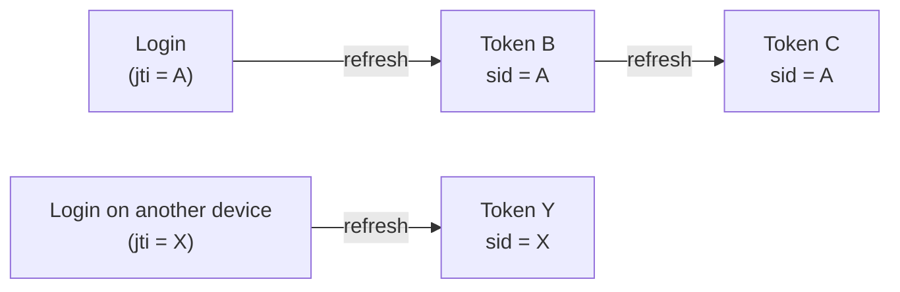

# Authentication & Sessions

Revel's API authenticates first-party clients with short-lived **JWT access tokens** and rotating **refresh tokens** (ninja-jwt), kept in a server-side ledger so that every session can be found and revoked. This page covers the token model, how sessions end, and the controls that guard sign-up and key material. Third-party apps use a separate credential system; see the [OAuth developer guide](../developer-guide/oauth.md).

## Token model

| Token | Lifetime | Setting |
|---|---|---|
| Access | 1 hour | `ACCESS_TOKEN_LIFETIME_HOURS` |
| Refresh | 30 days | `REFRESH_TOKEN_LIFETIME_DAYS` |

Tokens are HS256 JWTs signed with `SECRET_KEY` (see [Key rotation](#key-rotation)), with the audience from `JWT_AUDIENCE`. The API returns both tokens in the response body; the web frontend keeps the access token in memory only and stores the refresh token in an httpOnly cookie set by its own server. The backend never puts a JWT in a cookie (its only auth-flow cookie is the short-lived OIDC `state`).

`POST /api/auth/refresh` **rotates** the refresh token on every use: the presented token is blacklisted and a new pair is issued. Rotation is implemented in `accounts/service/token_refresh.py`, not by ninja-jwt's stock view.

## Lineages

Every refresh token belongs to a **lineage**, one login. The lineage id is the `sid` claim; the token a login mints has no `sid`, so its own `jti` stands in for it. Rotation stamps `sid` on every token it issues and records each one as an `OutstandingToken` owned by the user. Without that record, a revocation could not find tokens that were minted after the login.



Rotation, the reuse grace, logout and `blacklist_user_tokens` all take the **user-row lock** (`SELECT ... FOR NO KEY UPDATE`), so they serialize per user. A logout or a ban can therefore never miss a token that is being minted at the same moment.

## Logout

`POST /api/auth/logout` with `{"refresh": "<token>"}` returns `204` and revokes the presented token **and every live token of its lineage**. The user's other logins (another browser, a phone) stay signed in. A stale, already-rotated token still logs its own lineage out. An invalid, expired or forged token answers `401`.

The access token already issued stays valid until it expires (at most one hour); logout revokes the ability to refresh.

## Revoking every session

Some events end all of a user's sessions, not one lineage. They call `accounts.jwt.blacklist_user_tokens(user)`, which blacklists every outstanding refresh token (including those issued by rotation) and also revokes the OAuth app tokens the user authorized:

| Event | Where |
|---|---|
| Password reset | `accounts/service/account.py` |
| Email change confirmed | `accounts/service/account.py` |
| Global ban | `accounts/service/global_ban_service.py` |
| OIDC adoption of an unverified account | `accounts/service/oidc.py` |
| Adoption of an unverified account (verifying a contested one, password reset on an unverified one) | `accounts/service/account.py` |

A **tenant-domain** session is handled differently: it carries `tenant_host` claims and is refused whenever its host stops serving, on every request and at refresh time. See [White-Label](white-label.md).

### `credentials_changed_at`

Blacklisting refresh tokens leaves already-issued access tokens alive for up to an hour. `RevelUser.credentials_changed_at` closes that gap: when a password reset or the adoption of an unverified account (OIDC login, verifying a contested account) stamps it, any access token whose `iat` is earlier is refused with `401` (`common/auth_base.py`). `iat` has whole-second precision, so a token minted in the same second as the change still passes. The same timestamp voids pending email-change links and email-verification links issued before it. Verification links carry an `iat`; one minted before the account was stamped is refused. Links minted before they carried an `iat` are refused once the account has been stamped, and still work on an account that never was.

## Refresh reuse grace

A browser can lose the response to a refresh, or two tabs can refresh at once. Strict single-use rotation would log the user out in both cases, so a just-rotated token may be exchanged **once more** within `REFRESH_TOKEN_REUSE_GRACE_SECONDS` (default `30`; `0` is strict).

- The grace is **cache-backed**: rotation writes a `refresh_rotated:<jti>` marker and the second exchange claims a single-use `refresh_grace_used:<jti>` key. If the cache is unavailable the reuse is refused (fail strict), never a 500.
- Only rotation writes the marker, so a token blacklisted any other way (logout, password reset, ban) never qualifies.
- A lineage with no live token left cannot be revived by the grace, and inactive users never qualify.
- Replaying a rotated token outside the grace, or a second time inside it, is a `401`.

## Emailed link tokens

Single-use links sent by email (verify email, password reset, email-change confirmation, unsubscribe) fail with `400` and a stable machine-readable `code` instead of a message clients would have to match on:

```json
{"detail": "Token has expired.", "code": "token_expired"}
```

`code` is `invalid_token` or `token_expired` (`LinkTokenErrorSchema`, `accounts/exceptions.py`). `detail` is translated and must never be matched on. Renaming a code is a breaking change.

## OIDC sign-in and account adoption

Revel is an OIDC relying party ([ADR-0016](../adr/0016-oidc-relying-party.md)). When the IdP asserts a verified email that matches an existing account, the account is linked. If that existing account was **never verified**, nobody proved the address belonged to whoever set its password, so linking would let a pre-registered attacker keep access (fixed in v2.36.2). `_adopt_unverified_account` therefore resets it as if it had been created by OIDC:

- marked email-verified, with an **unusable password**;
- 2FA turned off and its secret regenerated;
- every session and app token revoked (`blacklist_user_tokens`);
- linked Telegram accounts detached;
- `credentials_changed_at` stamped.

A verified existing account is linked without any of this.

## Unverified accounts

Until its email is verified, nothing proves an account belongs to the person who set its password, 2FA or profile, and an unauthenticated request must never change what such an account stores.

**No session without a verified email.** `POST /auth/token/pair` (once the password is correct) and `POST /auth/token/pair/otp` answer `403` with `{"detail", "code": "email_not_verified"}` for a non-guest account whose email is unverified; a wrong password gets the usual refusal, so the response never says whether an account exists. The check is `auth_service.require_verified_email`. Refresh rotation refuses such an account like any other dead session (`401`, the presented token is blacklisted). Per-request access-token validation is unchanged. The frontend handles the code with a message and a "resend verification email" action. Guests never log in with a password and are not subject to the check; verification, email-change confirmation and OIDC all produce verified accounts before issuing a session.

**Repeat signup is a contest, not an overwrite.** `POST /account/register` with the address of an unverified account changes nothing the account stores. It stamps `RevelUser.signup_contested_at`, sends a fresh verification link, validates the referral code (`422` if invalid) without applying it, and answers `201` with a body built from the submitted payload only. A **verified** address still gets `400`, and so does a guest address (which also receives the activation email).

**Adoption.** The first proof of ownership restarts the account through `adopt_unverified_account` in `accounts/service/account.py`: `reset_unverified_credentials` (new password or an unusable one, 2FA off with a new secret, every session and app token revoked, Telegram accounts detached, `credentials_changed_at` stamped), then, only if the account was contested, a profile reset (preferred name, pronouns, bio, phone, picture; names and `language` are kept) and deletion of its `Referral`, then the account is marked verified and `signup_contested_at` cleared.

| Trigger | What happens |
|---|---|
| OIDC login asserting the address | Adopted with an unusable password. |
| Verification link on a **contested** account (old or new link) | Adopted with an unusable password; the response still carries a session, and a password-reset email is sent so the person can set a password. |
| Verification link on an uncontested account | Marked verified; password, profile and 2FA are kept. |
| Password reset on an unverified, non-guest account | Adopted with the new password (profile and referral reset only if contested). A verified account keeps its 2FA. |

`verify_email` loads the user with `select_for_update`, so concurrent links cannot interleave. Data the account created before a restart (tickets, memberships, questionnaire answers) stays attached to it. Creating an organization requires a verified email.

Every verification email also carries a "didn't sign up? delete your account" link to `/account/confirm-deletion`, the same link the verification reminders carry.

Referral invitations are enrolled by a single `post_save` receiver (`accounts/signals.py`) when a non-guest account becomes verified, whichever path does it.

## Bot protection (Cloudflare Turnstile)

`accounts/service/turnstile.py`, configured in `revel/settings/turnstile.py`.

- It is **on only when both** `TURNSTILE_SITE_KEY` and `TURNSTILE_SECRET_KEY` are set. A half-configured pair is treated as off (with a warning), so a typo cannot block every sign-up.
- It gates **registration**, **guest RSVP** (`/events/{id}/rsvp/{answer}/public`) and **guest checkout** (`/events/{id}/checkout/public`). Each takes a `turnstile_token` in its payload; a missing or rejected token is a `400`.
- It fails **closed** on a missing or rejected token (and on any 4xx from Cloudflare), and fails **open** when Cloudflare is unreachable or reports a 5xx or `internal-error`: an outage is not attacker-controlled, and blocking every real sign-up during one is the worse failure.
- On a [custom domain](white-label.md), the widget only renders on hostnames in its allowlist. The hostname must be listed for sign-up, guest RSVP and guest checkout alike; Revel keeps the list in step automatically. See [Turnstile](../guides/white-label/operators.md#turnstile).

## Key rotation

`SECRET_KEY` and `SALT_KEY` can be rotated without invalidating live tokens or encrypted data:

- Sign with `common.keys.signing_key()`; verify against `verification_keys()`, which is the current key followed by `SECRET_KEY_FALLBACKS`. Never read `settings.SECRET_KEY` directly.
- `SALT_KEY_FALLBACKS` does the same for encrypted fields, and `manage.py rotate_encrypted_fields` re-encrypts existing rows (`--dry-run` first, `--verify` after).
- Unsubscribe links outlive any fallback window, so they take their own list, `UNSUBSCRIBE_SIGNING_KEYS`. `manage.py check` warns with `common.W006` until it is set, and `common.W007` flags a primary salt containing a comma.
- Rotation is a two-phase rollout (introduce the new key as a fallback, then promote it), because old and new containers run side by side during a deploy.

The full procedure and its pitfalls are in [Engineering notes](../engineering-notes.md#key-rotation-secret_key-salt_key).

## Admin hardening

- State-changing admin actions (global ban, send verification / password-reset email, convert guest, retry delivery, domain activate/fail/remove, referral approve/reject) are declared with `permissions=["change"]`, so a view-only admin group can't run them.
- Reverting an object from its history page in the Django admin requires **change** permission, not just view (`HistoryRevertRequiresChangeMixin`).
- Log events pass through a scrubber that redacts password, token, secret and `Authorization` fields (`scrub_pii`), and Silk's sensitive-key list includes the refresh and access token fields.
- Silk (the profiler, off unless `SILK_PROFILER` is set) is browsable by superusers only, because it records request bodies and headers.

## Related

- [File Security](security.md): upload scanning and EXIF stripping
- [White-Label](white-label.md): tenant-bound sessions and Turnstile on custom domains
- [Third-party apps (OAuth)](../developer-guide/oauth.md): app tokens and what they can reach
- [ADR-0016: Generic OIDC login](../adr/0016-oidc-relying-party.md)
- [ADR-0018: OAuth 2.1 / OIDC provider](../adr/0018-oauth-oidc-provider.md)
- [Engineering notes](../engineering-notes.md): refresh rotation invariants and key rotation
