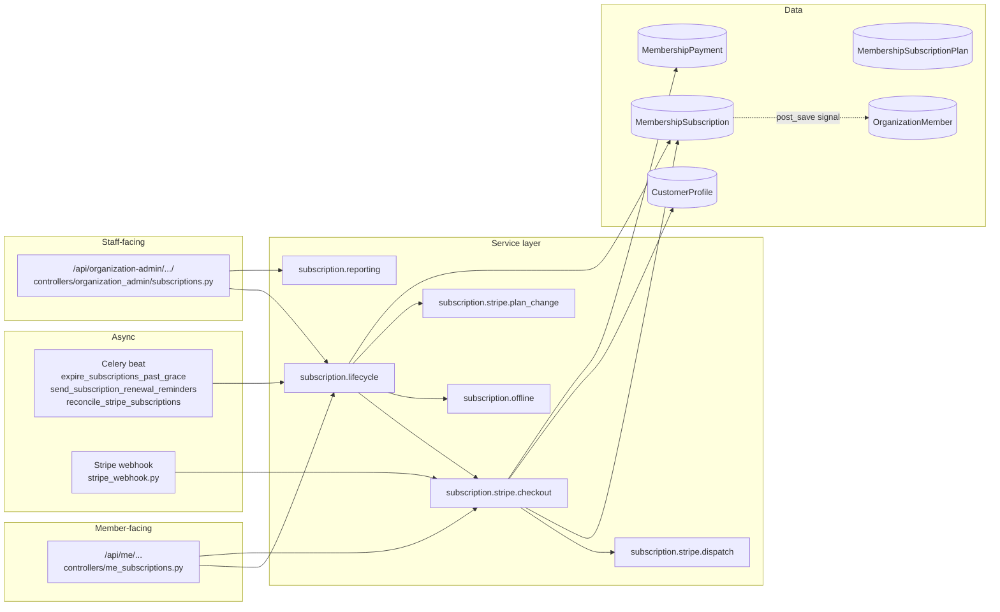

# Membership Subscriptions

Revel lets organizations charge recurring membership fees, with three collection
modes that share one local state machine:

- **OFFLINE**: Staff records payments by hand (cash, bank transfer, anything
  non-Stripe). The grace-expiry Celery beat task drives the state machine.
  Since v2.38.0 members can also join an OFFLINE plan themselves: the row waits
  in PENDING (the person held as `AWAITING_PAYMENT`) until staff record the first
  payment — see [Offline join flow](#offline-join-flow).
- **ONLINE**: Stripe Subscriptions on the org's Connect account. Stripe drives
  the state machine via webhooks; the local row mirrors what Stripe says.
- **FREE** (#832): no money at all. Members self-subscribe and the row lands
  ACTIVE immediately — no Stripe object, no checkout, nothing to collect. FREE
  plans are necessarily `LIFETIME`, so nothing ever renews or lapses either.
  This is the "free but *gated*" membership: the tier's questionnaire and
  manual-approval gates still have to pass, which is the whole reason the mode
  exists (a plan-less tier joins through `/apply`, which cannot enforce a
  subscription cap or a paused sale).

The split is captured in [ADR-0012](../adr/0012-membership-subscriptions-offline-online-hybrid.md);
the Stripe Connect model is captured in [ADR-0013](../adr/0013-stripe-connect-direct-charges-subscriptions.md);
the revival flow rules are captured in [ADR-0014](../adr/0014-subscription-terminal-states-and-revival.md);
the dunning + audit choices are captured in [ADR-0015](../adr/0015-reactive-dunning-and-simple-history-audit.md).

## Architecture Overview



## Data Model

All in `src/events/models/subscription.py`. Re-exported via
`events/models/__init__.py`.

### `MembershipSubscriptionPlan`

| Field | Notes |
|---|---|
| `tier` | FK to `MembershipTier` — multiple plans per tier (Monthly, Annual, …) |
| `name`, `description` | Operator-controlled |
| `payment_instructions` | Markdown, nullable. How to pay an OFFLINE plan. `effective_payment_instructions` returns this, falling back to `Organization.membership_payment_instructions`; empty when neither is set |
| `price`, `currency` | `Decimal(10,2)` + ISO 4217. Currency is validated against the platform's supported list. Bound to `payment_method` — see the shape rules below |
| `period_unit`, `period_count` | Rolling cadence — `(MONTH, 1)`, `(MONTH, 3)`, `(YEAR, 1)`, … — **or** `LIFETIME`, a non-renewing term. `LIFETIME` ignores `period_count`, leaves `current_period_end` NULL forever, and is therefore invisible to every renewal/lapse/expiry beat (they all filter on that column, which SQL NULL never matches) |
| `period_alignment` | `ROLLING` (default) or `CALENDAR`. A calendar plan's periods end on fixed boundaries at 00:00 UTC (the 1st of the next month, or the next 1st of `calendar_start_month` for yearly plans) instead of a fixed duration after the start. Calendar plans must be `MONTH` or `YEAR` with `period_count = 1`. **Create-only**: re-aligning would shift every subscriber's boundaries, and `period_unit` is locked too |
| `calendar_start_month` | 1-12, the month a calendar `YEAR` period starts on (e.g. 9 for a September season). Must stay 1 on any other plan. Create-only |
| `first_period_pricing` | `PRORATED` (default) or `FULL`: how a calendar plan prices the first, partial period. `PRORATED` scales `price` by the share of the period remaining, rounded half-up to the currency's minor unit (whole units for zero-decimal currencies such as JPY). Patchable (affects future joiners only); never `null` |
| `is_active` | Archived (`False`) plans are hidden from public listings but keep their FKs |
| `sales_status` | `OPEN` (default) / `PAUSED`. Pausing stops **member self-service** sales (subscribe, revive, switching into the plan) without touching existing subscribers; staff endpoints bypass it. Orthogonal to archiving: archived = retired, paused = temporarily closed |
| `max_subscriptions` | Cap on concurrent **non-terminal** subscriptions (the venue's "card stock"). `NULL` = unlimited. Counted live under a plan-row lock, so slots reclaim automatically when a subscription terminalizes — no counter to drift. Hard limit: applies to staff too |
| `payment_method` | `OFFLINE` (default), `ONLINE`, or `FREE`. **Not patchable** — see ADR-0012 |
| `stripe_product_id`, `stripe_price_id` | Provisioned lazily by `ensure_stripe_price` on the org's Connect account. Always empty for OFFLINE and FREE |
| `history` | `simple_history` audit table |

Constraint: `unique_plan_name_per_tier(tier, name)`. `clean()` also refuses a
plan on a `TEMPORARY` (day-membership) tier — see
[Member Register & Day Memberships](member-register.md).

#### Plan shape rules

`payment_method` constrains `price` and `period_unit`. Enforced once in
`events/utils/subscription_plan_rules.py:validate_plan_shape`, called from both
`PlanCreateSchema` (422 at create) and `subscription.lifecycle.update_plan` (400
at patch, against the *merged* post-patch values) so the two cannot drift.

| `payment_method` | `price` | `period_unit` | Why |
|---|---|---|---|
| `OFFLINE` | ≥ 0 | any, incl. `LIFETIME` | Staff settle off-book; `LIFETIME` expresses a one-off paid membership |
| `ONLINE` | > 0 | `MONTH` / `YEAR` only | Stripe has nothing to bill at 0, and its recurring intervals are month/year — a paid lifetime membership is expressible as OFFLINE, which has no Stripe object. `first_period_pricing = PRORATED` only (Stripe-native pro rata via `billing_cycle_anchor`, no trials or one-off line items; [ADR-0019](../adr/0019-calendar-aligned-membership-plans.md)). Calendar alignment is allowed |
| `FREE` | = 0 | `LIFETIME` only | A finite free term would be selected by the lapse beat and expire with no way to renew (there is no payment to record) |

#### Currency and cadence guard

`period_alignment`, `calendar_start_month` and a calendar plan's `period_unit` are
create-only: `clean()` refuses any change to them on an existing row on every `save()`
path, with or without subscribers (`update_plan` already refuses the unit and never
accepts the other two), and the plan admin shows alignment and start month read-only
once the plan exists. The same locked persisted read serves this check and the guard
below, and under `update_fields` a field not being written keeps its persisted value.

Changing `currency`, `period_unit` or `period_count` (the last is exempt on a
`LIFETIME` plan) is refused while the plan has non-terminal subscriptions on
`plan` or `pending_plan` (`MembershipSubscriptionPlan.has_live_subscriptions`).
`update_plan` enforces it under the plan row lock (400); `clean()` enforces it
against the persisted row for every other `save()` path (Django admin, history
revert, shell), as a field `ValidationError` (#1427). That check reads the persisted
row `FOR UPDATE`, which serializes the save with in-flight creations when it runs inside a
transaction (Django admin, `update_plan`); a bare autocommit shell save releases the lock before
the UPDATE, so shell edits need an enclosing `transaction.atomic()` to hold the lock through the write. It is skipped for `save(update_fields=...)` that names none of the guarded fields, and otherwise compares only the billing fields the save writes.

#### Sale controls

`ensure_plan_on_sale` (PAUSED check, member paths only — staff callers pass
`enforce_sales_status=False`) and `ensure_plan_sales_capacity` (cap check,
everyone) live in `subscription.sales` and are enforced on **create**,
**revive** and **plan switches**. The capacity check `select_for_update`s the
plan row (`FOR NO KEY UPDATE`) so concurrent creations serialize when a cap is set, mirroring the
capacity-reclaim invariants of ticket tiers. On an uncapped plan it takes `FOR KEY SHARE`
instead: creations don't block each other, but `update_plan`'s `FOR UPDATE` conflicts with it,
so the currency/cadence guard cannot miss a subscription in flight (#1427). Once locked, the
caller's plan instance is refreshed in place, so the rest of the creation uses the committed
currency, cadence, price, Stripe price and cap; the local sales-pause and active checks are not repeated after the lock, so a checkout
that passed them before a pause or archive committed carries on (an archived plan's Stripe Price may then reject the session). An uncapped plan that gained
a cap while the caller waited falls through to the capped path. The public plan schema exposes `sales_status` and a
computed `sold_out` flag so the frontend can render "sold out" vs "sales
paused" vs a normal subscribe CTA.

### `MembershipSubscription`

| Field | Notes |
|---|---|
| `user`, `plan`, `organization` | `organization` is denormalized for permission/query simplicity; `clean()` enforces `plan.tier.organization_id == organization_id` |
| `status` | See [State Machine](#state-machine) |
| `current_period_start` / `current_period_end` | Driven by `record_payment` (OFFLINE) or `invoice.paid` (ONLINE). On a `LIFETIME` plan `current_period_end` stays **NULL forever** — that NULL is what keeps the beats away from it |
| `cancel_at_period_end`, `cancelled_at` | Scheduled vs. immediate cancellation |
| `expired_at` | Stamped on every transition into EXPIRED. Drives revival window |
| `held_member` | OFFLINE plans only, nullable. `True`: this subscription put the member into `AWAITING_PAYMENT` (created or reactivated the row); `False`: the member already existed and is never touched on close; `NULL`: legacy row from before it was tracked |
| `stripe_subscription_id` | Unique; nullable. Populated after the Stripe Subscription is created |
| `stripe_checkout_session_id` | Hosted Checkout Session that will (or did) create the Stripe Subscription; blank otherwise |
| `pending_plan`, `stripe_schedule_id` | Downgrade flow: the schedule's second phase resolves on `customer.subscription.updated` |
| `history` | `simple_history` audit table |

Class attribute `TERMINAL_STATUSES = frozenset({"cancelled", "expired"})` is
the single runtime source of truth. The same tuple
(`_TERMINAL_STATUS_VALUES`) is referenced from `Meta.constraints` so the
partial-unique index and the runtime check can never diverge.

Constraints / indexes:

- `one_active_subscription_per_user_org` — partial unique on `(user,
  organization)` excluding terminal statuses. Lets a member create a fresh
  subscription cleanly once a previous one is CANCELLED or EXPIRED.
- `Index(organization, status)` and `Index(user, status)` — list/dashboard
  queries.
- `Index(current_period_end)` — daily scan in the expiry beat task.

### `MembershipPayment`

A payment recorded against a subscription. OFFLINE: created by
`record_payment`. ONLINE: created/upserted by `record_stripe_payment_from_invoice`
(`subscription/stripe/sync.py`) on `invoice.paid` / `invoice.payment_failed`. The
unique-by-side-effect key is `stripe_invoice_id` (uses `update_or_create` for
webhook idempotency). `occurred_at` is the staff-supplied payment date (backfills);
render `occurred_at ?? created_at`.

`status` is `PENDING` / `SUCCEEDED` / `FAILED` / `REFUNDED` / `VOIDED`. `VOIDED`
marks a manual payment staff entered by mistake: the row is kept for the audit
trail but never counts as money (revenue and MRR aggregates filter on positive
statuses) and is hidden from the staff and member payment lists unless
`include_voided` is set (staff) — see `void_payment` below.

### `CustomerProfile`

Per-(user, organization) Stripe Customer reference. Created lazily by
`ensure_customer_profile`. Two constraints keep duplicates out:
`unique_customer_per_user_org(user, org)` and
`unique_stripe_customer_per_org(organization, stripe_customer_id)`.

### `Organization` additions

- `membership_grace_period_days` (default `7`) — how long PAST_DUE lasts
  before EXPIRED.
- `membership_refund_policy` — markdown, displayed to members.
- `membership_payment_instructions` — markdown, default "how to pay offline"
  text used by OFFLINE plans that do not set their own `payment_instructions`.
- `membership_subscription_revival_window_days` (default `30`) — how long
  after `expired_at` revival is allowed. `0` disables revival entirely.

## State Machine

```text
                    record_payment
PENDING ─────────────────────────────────► ACTIVE ◄───────────────────┐
   │ (ONLINE: invoice.paid)                  │ ▲                       │
   │                                         │ │ resume                │ record_payment / invoice.paid
   │                                pause    ▼ │                       │
   │                                       PAUSED                      │
   │                                                                   │
ACTIVE  ──(period_end<now, !cancel_at_period_end, Celery)──► PAST_DUE ─┘
ACTIVE  ──(period_end<now, cancel_at_period_end=True, Celery)──► CANCELLED (terminal)
PAST_DUE ──(period_end + grace_days < now, Celery)──► EXPIRED            (terminal)

ACTIVE/PAUSED ──(cancel_subscription, immediate=True)──► CANCELLED       (terminal)
ACTIVE/PAUSED/PAST_DUE ──(cancel_subscription, immediate=False)──► (unchanged, cancel_at_period_end=True)

EXPIRED ──(revive_subscription within window)──► ACTIVE (OFFLINE) / PENDING (ONLINE, awaits invoice.paid)

OFFLINE join (no payment yet):
PENDING (never paid) ──(first SUCCEEDED payment)──► ACTIVE
PENDING (never paid) ──(30 days, Celery)──► CANCELLED
ACTIVE (one payment) ──(void that payment)──► PENDING again (never paid)
```

A never-paid OFFLINE row cannot be paused or manually activated: it has no
period to freeze, and the only thing that activates it is a payment.

Key invariants:

- Terminal subscriptions (`CANCELLED`, `EXPIRED`) **never** advance their
  period. `record_payment` raises 400; `_apply_stripe_price_swap`
  short-circuits.
- **CANCELLED vs. EXPIRED is the revival discriminator.** EXPIRED means an
  involuntary lapse — `expired_at` is stamped and the org's revival window
  applies. CANCELLED means the member (or staff) chose to stop, whether
  immediately or at the period boundary; `expired_at` stays `NULL` and
  `revive_subscription` refuses the row. A lapsed ACTIVE row with
  `cancel_at_period_end=True` therefore lands **CANCELLED**, not EXPIRED
  (`_terminalize_cancelled_row`), so the member is never offered a "revive?"
  CTA for a cancellation they asked for.
- Subscription tier wins over member tier on the `OrganizationMember` sync
  signal — see [Member Sync](#member-sync-signal).
- ONLINE subscriptions in PENDING do **not** grant ACTIVE membership. The
  member is only synced ACTIVE once Stripe confirms the first invoice (or
  the Stripe webhook reports `status=active`).
- OFFLINE subscriptions in PENDING do not grant it either: the person is held
  as `OrganizationMember.MembershipStatus.AWAITING_PAYMENT` (holds a slot,
  grants nothing) until the first payment is recorded.

## Offline join flow

Added in v2.38.0 (migration `0144_offline_membership_flow`). Before it, OFFLINE
plans were staff-only and creating a subscription made the member ACTIVE up
front. See the amendment in
[ADR-0012](../adr/0012-membership-subscriptions-offline-online-hybrid.md).

```mermaid
sequenceDiagram
    participant M as Member
    participant API as /subscribe or /apply
    participant Off as subscription.offline
    participant S as Staff
    M->>API: join an OFFLINE plan
    API->>Off: open_offline_subscription
    Off-->>M: PENDING subscription, member AWAITING_PAYMENT,<br>MEMBERSHIP_PAYMENT_REQUESTED
    S->>Off: record first payment (record_payment)
    Off->>Off: activate_on_first_payment
    Off-->>M: subscription ACTIVE, member ACTIVE, MEMBERSHIP_GRANTED
```

Code: `src/events/service/subscription/offline.py`; predicates in
`src/events/utils/subscription_payment.py`.

- **Entry points.** `subscribe_to_plan` (`/subscribe`), an approved or
  approval-off `/apply` on a plan-bearing tier (see
  [Membership Eligibility](membership-eligibility.md)), and staff
  `create_staff_subscription` without an initial payment all route to
  `open_offline_subscription`. It is idempotent: a never-paid subscription the
  user already holds on the plan is returned as is, with no second notification.
  Member-facing joins refuse a paused plan (`ensure_plan_on_sale`).
- **Holding the member.** `create_subscription` calls
  `_hold_member_awaiting_payment`: a new or CANCELLED member becomes
  `AWAITING_PAYMENT` at the plan's tier; an existing member keeps their tier and
  status until the first payment. `held_member` records which case happened.
- **First payment.** `record_payment` detects a never-paid row
  (`is_never_paid_offline`) and calls `activate_on_first_payment` before the
  subscription is saved: an `AWAITING_PAYMENT` member becomes ACTIVE at the plan's
  tier and gets `MEMBERSHIP_GRANTED`; an already-active member (a free member
  upgrading) moves to the plan's tier and receives a payment receipt; PAUSED and
  BANNED members are left alone. Finally `settle_originating_application` moves
  the linked application to COMPLETED. A hard-blacklisted user's first payment is
  refused (`refuse_blacklisted_first_payment`, 400).
- **Notifications.** `MEMBERSHIP_PAYMENT_REQUESTED` goes to the member (mandatory
  type) and carries the plan's `effective_payment_instructions`;
  `MEMBERSHIP_OFFLINE_JOINED` goes to staff when a member joins directly, i.e.
  without an application that staff already saw.
- **Voiding the only payment.** `void_payment` / `update_payment` leave the row
  never-paid again; `revert_to_awaiting_payment` then holds the member as
  `AWAITING_PAYMENT` once more (only when `held_member` / the legacy heuristic
  says the subscription held it).
- **Never-paid cleanup.** Staff cancel, a ban or removal
  (`cancel_subscriptions_for_membership_loss`), or the 30-day sweep
  (`events.expire_unpaid_offline_subscriptions`) terminalise the row;
  `close_unpaid_offline` then cancels the originating application and releases
  the held member (never one that pre-existed) so the person can join again. The
  window is `APPLICATION_PAYMENT_WINDOW_DAYS` (30) from the later of creation and
  last payment activity, exposed to clients as `payment_due_by`. A row with a
  SUCCEEDED or REFUNDED payment is never swept.

## Service Layer

The service lives in the `events/service/subscription/` package: the local
state machine at the top level (`core`, `lifecycle`, `offline`, `payment_edits`,
`plans`, `sales`, `eligibility`, `uncancel`, `refunds`, `reporting`,
`notifications`) and the Stripe integration under `subscription/stripe/`
(`base`, `checkout`, `sync`, `plan_change`, `dispatch`, `fees`, `payloads`). Every public symbol is
re-exported from `subscription/__init__.py`.

### `events/service/subscription/core.py` and `lifecycle.py`

Function-based services that own the per-subscription OFFLINE flow and the
dispatch layer for ONLINE operations. `core.py` holds `create_subscription` and
`record_payment` (plus the `InitialPayment` dataclass: amount, currency,
`recorded_by`, notes, optional `occurred_at`); `lifecycle.py` holds the rest.
Plan CRUD and price migration live in `subscription/plans.py`.

| Function | Responsibility |
|---|---|
| `create_subscription` | Refuses archived plans, BANNED and hard-blacklisted users, duplicate non-terminal subs, and cap-full plans (`ensure_plan_sales_capacity`, under the plan-row lock). OFFLINE and FREE only — ONLINE goes via `start_online_subscription` so the user can confirm payment. An **OFFLINE** plan holds the person as `AWAITING_PAYMENT` (`_hold_member_awaiting_payment`; an existing member keeps their tier and status until the first payment) and stores the outcome on `held_member`. A **FREE** plan creates/updates the member ACTIVE and lands the row **ACTIVE** with `current_period_start=now` and a NULL period end (nothing to pay, nothing to renew). An optional `initial_payment` is recorded via `record_payment(is_initial=True)` |
| `create_staff_subscription` | Staff entry point. An OFFLINE plan without an initial payment goes through `offline.open_offline_subscription` (member held, payment request sent, idempotent); everything else is `create_subscription` |
| `record_payment` | Advances `current_period_*`, revives PENDING/PAST_DUE → ACTIVE. Refuses terminal. Accepts `occurred_at` (backfill anchor, validated against future dates and already-lapsed periods) and `is_initial`. On a never-paid OFFLINE row it calls `offline.activate_on_first_payment` and refuses hard-blacklisted users. Dispatches `RENEWAL_SUCCEEDED` only on a real renewal (prior_status ∈ {ACTIVE, PAST_DUE}). `dispatch_renewal_notification=False` for revival callers |
| `cancel_subscription` | `immediate=True` → CANCELLED. `immediate=False` → `cancel_at_period_end=True` and let the beat task finish it. Refuses scheduled cancel on PAUSED (frozen time would never reach the boundary). A **period-less** row — any LIFETIME/FREE subscription, or an unpaid checkout — has no boundary to wait for, so a scheduled cancel is upgraded to immediate (the one exception is a row whose Stripe Subscription is already linked: Stripe owns that boundary). Routes ONLINE through `cancel_online_subscription` |
| `pause_subscription` / `resume_subscription` | Local for OFFLINE; routes to Stripe `pause_collection` for ONLINE. Refuses ONLINE without `stripe_subscription_id` to keep local PAUSED in lockstep with Stripe |
| `revive_subscription` | EXPIRED → ACTIVE (OFFLINE, with `initial_payment` — staff callers only; the member endpoint refuses OFFLINE plans) or PENDING + hosted Checkout for a fresh Stripe Subscription (ONLINE); staff-initiated ONLINE revivals also email the member the checkout link (`SUBSCRIPTION_REVIVAL_CHECKOUT`). Enforces the plan cap (a revived sub re-occupies a slot) and, for member callers, `sales_status` (`enforce_sales_status=False` for staff) |
| `change_plan` | Routes ONLINE to `subscription.stripe.plan_change.change_online_plan`; OFFLINE does an immediate same-org/same-currency swap |
| `staff_change_plan` | Staff plan change for OFFLINE / FREE rows. Pre-checks every refusal as a coded 409 (`SubscriptionPlanChangeRefusedError`, codes in `SubscriptionPlanChangeRefusalCode`: `plan_change_online`, `subscription_terminal`, `subscription_paused`, `plan_unchanged`, `plan_archived`, `plan_payment_method_mismatch`, `plan_currency_mismatch`), then delegates to `change_plan` skipping the sales pause and cross-tier eligibility gates; the plan cap still applies (400) |
| `cancel_subscriptions_for_membership_loss` | Terminalises a user's live subscriptions when they are banned or removed (and on account deletion), so billing stops. ONLINE Stripe cancel / checkout-session expiry is deferred to `on_commit` and best-effort. `rejoinable` tells a never-paid offline member whether they may join again (False for ban/blacklist/deletion, True for a plain removal) |
| `refund_payment` | (in `subscription.refunds`) Marks payment REFUNDED and stamps `refund_amount` / `refunded_at`. If the refund fully covers the current period → `_cancel_refunded_subscription`, **not** `cancel_subscription(immediate=True)`: the refund callers already hold row locks, so the local row is terminalized (CANCELLED) under the lock and the Stripe-side cancel is deferred to `on_commit` as a best-effort call — never a network call under a row lock |
| `_dispatch_*` | Private notification helpers — one per `NotificationType`. Always render via the existing notification dispatcher |

### `events/service/subscription/offline.py`

The offline join flow; see [Offline join flow](#offline-join-flow).

| Function | Responsibility |
|---|---|
| `open_offline_subscription` | Idempotently opens the PENDING subscription of a user joining an OFFLINE plan, links/approves the originating application, and dispatches `MEMBERSHIP_PAYMENT_REQUESTED` (plus `MEMBERSHIP_OFFLINE_JOINED` to staff for direct member joins) on commit |
| `activate_on_first_payment` | Applies the first SUCCEEDED payment: `AWAITING_PAYMENT` member → ACTIVE (+ `MEMBERSHIP_GRANTED`), tier follows the plan, application settles COMPLETED |
| `close_unpaid_offline` | After a never-paid OFFLINE row is terminalised: cancels its application and the member held for it |
| `revert_to_awaiting_payment` | After a void leaves the row never-paid: member back to `AWAITING_PAYMENT` |
| `refuse_blacklisted_first_payment` | 400 for a hard-blacklisted user's first payment |

### `events/service/subscription/payment_edits.py`

Staff corrections to manual (OFFLINE) payments. No notification is ever sent and
simple-history records every change. Eligibility rules live in
`events/utils/membership_payment_rules.py`, shared with the `can_edit` / `can_void`
flags the API exposes.

| Function | Responsibility |
|---|---|
| `update_payment` | Changes `amount` / `notes` on any eligible row. Changing `status` or `occurred_at` additionally needs the row to be the subscription's latest non-voided payment on a non-terminal subscription; the period is then recomputed from the previous SUCCEEDED payment. Editing the first payment to SUCCEEDED triggers `activate_on_first_payment` (without a receipt) |
| `void_payment` | Sets status `VOIDED`, appends the reason to `notes`, rolls the subscription period back. Same eligibility as a period edit. Access is not revoked directly; a row left never-paid reverts its held member to `AWAITING_PAYMENT` |

Refusals raise `MembershipPaymentEditRefusedError` (409) with a stable code:
`payment_online`, `payment_refunded`, `payment_voided`, `payment_not_latest`,
`subscription_terminal`.

### `events/service/subscription/eligibility.py`, `sales.py`, `uncancel.py`

| Function | Responsibility |
|---|---|
| `eligibility.subscribe_to_plan` | The `/subscribe` workflow: runs the membership gate stack, then activates by payment method (OFFLINE → `open_offline_subscription`, FREE → ACTIVE row, ONLINE → Checkout) and links/settles the originating application. Lives apart from `lifecycle` so the money modules do not depend on `membership_manager` |
| `eligibility.ensure_tier_change_allowed` | Gate stack for cross-tier `change-plan` targets; same-tier swaps are not re-gated |
| `sales.ensure_plan_on_sale` / `ensure_plan_sales_capacity` | PAUSED and cap checks (see [Sale controls](#sale-controls)) |
| `sales.ensure_member_not_excluded` | Refuses BANNED / hard-blacklisted users. Member-facing callers get one neutral 403 so a blacklist is never confirmed; staff get the specific reason |
| `uncancel.uncancel_subscription` | Exact inverse of `cancel_subscription(immediate=False)`: clears `cancel_at_period_end` (and on Stripe for ONLINE rows). Refuses terminal rows, archived plans and suspended (PAUSED / BANNED) members; a row not scheduled to cancel is returned unchanged |

### `events/service/subscription/plans.py`

Everything that operates on a plan rather than on one subscriber's lifecycle.

| Function | Responsibility |
|---|---|
| `create_plan` / `update_plan` / `archive_plan` / `delete_plan` | Plan CRUD. ONLINE plans trigger `ensure_stripe_price`. `update_plan` re-reads the plan under `select_for_update` and refuses currency and cadence (`period_unit` / `period_count`) edits while the plan has non-terminal subscriptions, including subscriptions with a downgrade scheduled into it (`pending_plan`); a `period_count` edit on a `LIFETIME` plan is allowed, since `LIFETIME` ignores it. Why (#1423): moving an ONLINE subscriber to a Price with another interval under `proration_behavior='none'` depends on the subscription's Stripe billing mode. Flexible mode stretches the paid period without an invoice (observed in test mode); classic mode resets the billing date and charges the new Price at once. `delete_plan` catches `ProtectedError` from the FK |
| `migrate_plan_subscribers` | Force-migrates non-terminal subs on a plan to its current Stripe price (`proration_behavior='none'`). Per-sub errors are reported individually; no rollback. Each ONLINE sub is re-read under a row lock (`change_online_plan` holds the same lock) and skipped if its plan changed, it went terminal or it gained a schedule since the batch query, so a member's own plan change is never overwritten (#1427); OFFLINE subs get the same plan/terminal re-check just before their notice. Before each swap the subscriber's current Price and the plan's current Price are compared directly (not against the plan row): both must recur, with the same `interval` and `interval_count`, or the subscriber is reported as failed and never swapped (#1423). Batches the "previous price" lookup through the shared `last_paid_amounts` helper (`Coalesce(full_period_amount, amount)`, so a prorated calendar stub quotes the full price) |

### `events/service/subscription/stripe/base.py`, `checkout.py`, `sync.py`

`base.py` holds `require_stripe_connected` and `ensure_stripe_price`; `sync.py`
holds everything that mirrors Stripe state into local rows
(`sync_subscription_from_stripe`, `record_stripe_payment_from_invoice`,
`_ensure_active_member`, `settle_originating_application`).

| Function | Responsibility |
|---|---|
| `ensure_customer_profile` | Get-or-create the per-(user, org) Stripe Customer. Deterministic `idempotency_key=cust:{user}:{org}` |
| `ensure_stripe_price` (`base.py`) | Create/refresh Stripe Product+Price for an ONLINE plan. Detects price-input changes (`_price_inputs_changed`) and archives the old Price + creates a new one (Stripe Prices are immutable) |
| `archive_stripe_price` | Deactivates the Stripe Price when a plan is archived — existing subscribers keep paying via their own subscription's price binding |
| `start_online_subscription` | Refuses PAUSED plans (member path), then creates local PENDING row, then a hosted Checkout Session (`mode='subscription'`) on the org's Connect account. Returns `checkout_url`; the session id lands on `stripe_checkout_session_id` and the Stripe Subscription is only created (and linked via `checkout.session.completed`) when the member completes the session. Rolls back the local row if Stripe fails. An existing PENDING row is resumed (same session `url`) while its session is still `open` on the same plan, expired + cleared when superseded (revival rows revert to EXPIRED instead of deleting the ledger), or answered with a `SubscriptionActivationPendingError` (409, `code=subscription_activation_pending`) when the session already completed and only the activation webhooks are outstanding |
| `create_revival_checkout` | Mints a hosted Checkout Session for a fresh Stripe Subscription on an EXPIRED row (old Stripe sub cancelled first — a failure here fails the revival, since the id is about to be cleared — then `stripe_subscription_id` cleared, row → PENDING). Idempotency key is **per attempt** (`sub-revival:{pk}:{uuid4}`): anchoring it on `expired_at` would repeat the key across retries after an abandoned checkout (which preserves `expired_at`) while the session's `expires_at` is recomputed from `now()` — same key, different params, which Stripe rejects for ~24h. The caller's row lock serializes concurrent attempts, and a `mode=subscription` session only charges on completion, so an orphaned session cannot double-charge. The old `stripe_subscription_id` survives in `historical_membership_subscription` |
| Calendar plans in `_create_subscription_checkout_session` | For a calendar plan the session carries `subscription_data.billing_cycle_anchor = <next boundary>` and `proration_behavior` of `"create_prorations"`, or `"none"` for a free stub (`subscription_periods.is_free_stub`: prorated price below Stripe's minimum charge for the currency, or under an hour to the boundary, decided at the session's latest completion time because Stripe prorates at completion; billing then simply starts at the boundary). Both `start_online_subscription` and `create_revival_checkout` go through it. `expires_at` is capped one minute before the boundary and floored 31 minutes after creation (Stripe's minimum is 30). A session minted in the last half hour can still complete after the boundary, but it is a free stub, so it just pays the first full period from the anchor (Stripe's documented behavior, not probed); an open session whose boundary has passed is treated as stale by `_maybe_resume_pending_checkout` (expired, replaced). The prorated first invoice (`billing_reason=subscription_create`, one proration line) is recorded by `record_stripe_payment_from_invoice` with `full_period_amount` resolved from the line's Stripe Price id (`plan.price` when it is the plan's own price, else retrieved; never the line's `unit_amount_decimal`; the `plan.price` shortcut only when the line's Price id is the plan's, never when the line has no Price id; best-effort: on a Stripe error, an unusable Price or a missing Price id the stamp falls back to `plan.price` and is logged at WARNING with subscription/invoice/price ids, so the member is still linked, activated and recorded; the stub decision is re-taken under the row lock against the locked plan; stamped once; helpers in `stripe/calendar_stub.py`), and its period, join to boundary, comes from the proration line when no recurring line exists (the realistic path when `customer.subscription.*` beat `checkout.session.completed`). A free stub records a zero ledger row without PaymentIntent/fee alarms, or no invoice at all, in which case `checkout.session.completed` mirrors the Subscription. Boundary renewals are ordinary recurring invoices and are not stamped. The revival/checkout-link notice quotes `first_period_price` (zero for a free stub) and states the next full charge and its date (the first boundary), known before payment; post-payment notices carry no next-charge line, and the renewal-reminder beat covers every later charge. The free-stub window is bounded by the session expiry (`PAYMENT_DEFAULT_EXPIRY_MINUTES`) because the decision covers the latest completion time |
| `cancel_online_subscription`, `pause_online_subscription`, `resume_online_subscription` | Stripe mutations + local mirror. The dispatch helpers in `subscription.lifecycle` cover the OFFLINE-equivalent local-only behavior |
| `update_subscription_price` | Single-call Stripe price swap used by `migrate_plan_subscribers`. `proration_behavior='none'` — new price takes effect at the next renewal |
| `create_billing_portal_session` | Customer Portal URL on the org's Connect account. **Requires** an existing `CustomerProfile` (404 otherwise) — only members who have actually subscribed can get a portal session |
| `sync_subscription_from_stripe` (`sync.py`) | Mirrors `customer.subscription.{created,updated,deleted}` payloads. Uses `_resolve_target_status` (terminal wins over `pause_collection`), `_apply_period_dates`, and `_apply_stripe_price_swap` (terminal rows frozen) |
| `record_stripe_payment_from_invoice` (`sync.py`) | Upserts the `MembershipPayment` row on `invoice.paid` / `invoice.payment_failed`. `update_or_create(stripe_invoice_id=...)` is the idempotency anchor |

### `events/service/subscription/stripe/fees.py`

The platform's `application_fee_percent` — the only fee mechanism Stripe offers
for subscriptions, so the org fee **and the VAT on it** are folded into a single
percent (`effective_application_fee_percent`; the fixed fee component does not
apply to subscriptions). `resync_subscription_application_fees` pushes today's
percent onto every live ONLINE subscription when an org's VAT status changes,
skipping schedule-managed rows (Stripe rejects a plain `Subscription.modify`
while a schedule is attached) and counting per-subscription failures instead of
raising.

### `events/service/subscription/stripe/plan_change.py`

Extracted from `subscription/stripe/checkout.py` to stay under the 1000-line
file limit. All plan-change logic for ONLINE subs:

- `lifecycle._validate_change_plan_target` refuses (400) an ONLINE switch to a plan on
  another billing grid (`subscription_periods.same_period_grid`): both paths below keep
  Stripe's anchor, so only rolling to rolling, or calendar to calendar with the same
  unit and start month, is allowed (ADR-0019).
- `_classify_plan_change` normalizes both prices to a per-month figure
  (`_monthly_equivalent_price`) before comparing, so a Monthly →
  Annual swap is classified on per-month cost, not raw headline price.
- `_upgrade_online_subscription` (more expensive per month): immediate Stripe
  `Subscription.modify` with `proration_behavior='always_invoice'` and
  `payment_behavior='allow_incomplete'`. Local plan is swapped synchronously
  so the API response reflects the change without waiting for the webhook —
  which is exactly why the proration must be invoiced **on the spot** rather
  than merely queued. `create_prorations` only parks line items on the *next*
  invoice, so the member would hold the pricier tier free for a whole cycle,
  and an immediate cancel (Stripe defaults to `invoice_now=False,
  prorate=False`) would discard the delta outright. If the invoice fails, the
  subscription goes `past_due` and the normal dunning flow takes over; the
  price swap stands either way.
- `_downgrade_online_subscription` (cheaper or equal per month): Stripe
  `SubscriptionSchedule` with two phases (current price for the rest of the
  period; new price after, for a `duration` of one new-plan billing period —
  `iterations` was removed by the pinned Stripe API version).
  `end_behavior='release'` falls back to a normal rolling renewal at the new
  price once that second phase completes. Local
  row carries `pending_plan` + `stripe_schedule_id` until the phase
  transition arrives via `customer.subscription.updated`, at which point
  `_apply_stripe_price_swap` clears both fields.

### `events/service/subscription/stripe/dispatch.py`

Notification dispatch helpers for the Stripe sync/invoice code paths.
Holds the gates that prevent double-firing on re-delivered webhooks:

- `_dispatch_sync_notifications` — gated on transitions captured by
  `prior_status` / `prior_cap` snapshots.
- `_dispatch_invoice_notifications` — gated on `payment_created` (from
  `update_or_create`) and `prior_status` so the first invoice of a brand-new
  subscription does not fire `RENEWAL_SUCCEEDED`.

### `events/service/subscription/reporting.py`

Per-organization metrics for the admin dashboard:

- **`active_count`** = ACTIVE + PAST_DUE (still-paying customers).
- **`mrr`** = sum, over the `active_count` subs, of each sub's monthly
  equivalent. The per-sub amount is **the subscriber's latest successful
  non-proration payment**, falling back to `plan.price` when there is none
  (OFFLINE pre-payment, brand-new rows) — grandfathered ONLINE subscribers
  keep paying their old Stripe price, so `plan.price` alone would overstate
  them, and a one-off proration charge from a plan change is not a recurring
  amount. A subscription's **first** payment on a PRORATED calendar plan, when it
  covers a stub (a mid-period join), stores the plan's full per-period price in
  `MembershipPayment.full_period_amount` (`core._full_period_amount`: no previous
  period, payment advances the period, period start is not exactly a calendar
  boundary; null otherwise). A join exactly on a boundary stores nothing, and a
  late renewal, though it starts mid-period, is paid in full and anchors on what
  was paid. The stub after a rolling-to-calendar switch is not stamped either
  (payments don't record their plan), so it counts at its paid amount for that
  one period. A staff edit keeps an already-recorded value while the payment is
  still a prorated first period (a later plan price change never rewrites it) and
  clears it otherwise. The anchor is
  `Coalesce(full_period_amount, amount)`, computed by **one shared helper**,
  `notifications.last_paid_amounts`, used by MRR, price-migration notices and
  renewal reminders alike (one batched `DISTINCT ON` query, N+1-free). A
  concession amount on a prorated stub still anchors at list price (accepted).
  Annual plans divide by `period_count * 12`. The
  sum is quantized **once** at the end (`Decimal("0.01")`) to avoid
  accumulated rounding drift.
- **`mrr_currency`** = the shared currency, or `"MIXED"` (with
  `mixed_currency_warning=True` and `mrr=0`) if the org has subs in
  multiple currencies.
- **`churned_30d`** = subs that transitioned to CANCELLED/EXPIRED in the
  last 30 days (`cancelled_at >= cutoff OR expired_at >= cutoff`).
- **`churn_rate_30d`** = `churned_30d / (active_count + churned_30d)` —
  intentional approximation; see Phase 4 spec §9.

A single aggregate query produces the status breakdown; the MRR loop uses
`select_related("plan")` plus the batched payment lookup above to avoid N+1.
`LIFETIME` plans normalize to **0** monthly: they are one-off, so folding them
into MRR would inflate it permanently off a payment that happens once — or, for
FREE plans, never.

### `events/utils/subscription_periods.py`

Pure utilities:

- `calculate_period_end(period_start, plan)` — for a `CALENDAR` plan returns
  the next 00:00 UTC boundary strictly after `period_start` (so renewals
  chaining from a boundary get the following one). `first_period(plan, at)`
  (built on `first_period_end` / `first_period_price`) gives the first period's end and
  (prorated or full, rounded to the currency's minor unit) price for a member joining at
  a given instant; both are `None` on rolling plans. The plan schemas expose them through
  one mixin that reads the clock once per plan; the schema nested under a member's own
  subscription omits them, since a join-now quote is misleading there.
  For rolling plans it uses
  `dateutil.relativedelta` so Jan 31 + 1 month → Feb 28/29 behaves
  correctly. Explicit branch on `plan.period_unit` (`MONTH` / `YEAR`) so a
  future unit isn't silently treated as months. Returns **`None`** for
  `LIFETIME`; callers must propagate that NULL rather than substituting a
  date. (`record_payment` is the one place that needs a non-null value anyway —
  `MembershipPayment.period_end` is `NOT NULL` — so a lifetime payment is
  recorded as the point event it is, `period_end == period_start`, while the
  subscription's own `current_period_end` stays NULL.)
- `REMINDER_DAYS = 3` — used by the renewal-reminder beat task.

## Permissions

A new `manage_subscriptions` permission on `PermissionMap` (default: owner ✓,
staff ✓, member ✗). Used by `OrganizationPermission("manage_subscriptions")`
on the admin controller. Members access their own subscriptions through the
JWT-authenticated `MeSubscriptionsController` (no permission gate; `self.user()`
scopes every query).

## Member Sync (signal)

`events/signals.py::sync_member_from_subscription` listens to `post_save` on
`MembershipSubscription`:

| Subscription status | OrganizationMember status |
|---|---|
| PENDING (ONLINE) | unchanged — waits for `invoice.paid` |
| PENDING (OFFLINE, never paid) | unchanged — the member stays `AWAITING_PAYMENT` (or whatever they were) |
| ACTIVE / PAST_DUE (and PENDING OFFLINE once paid) | ACTIVE |
| PAUSED | PAUSED |
| CANCELLED / EXPIRED | CANCELLED |
| CANCELLED / EXPIRED, never paid (OFFLINE) | not synced; `close_unpaid_offline` releases only the member held for it |

Rules baked into the signal:

- **Never creates a member.** Creation lives in
  `create_subscription` (OFFLINE and FREE) or `_ensure_active_member` (ONLINE,
  gated on the first paid invoice).
- **Leaves BANNED alone.** A banned member stays banned regardless of
  subscription activity.
- **Never moves a member out of `AWAITING_PAYMENT`.** Only
  `activate_on_first_payment` does (`_subscription_cannot_move`). While an
  OFFLINE subscription is never-paid the signal moves neither status nor tier
  (`_never_paid_offline_handled`), so `staff_change_plan` on such a row moves the
  member's tier only at first payment.
- **Subscription tier wins.** `member.tier` is updated to `plan.tier` on
  every sync.
- **Older terminal rows do not clobber.** If a newer non-terminal sub
  exists for the same (user, org), the signal returns early — re-saving a
  historical CANCELLED row from the admin must not flip the user back to
  CANCELLED.

## Async Surface

### Celery tasks

All in `src/events/tasks/subscriptions.py`.

| Task | Schedule | Purpose |
|---|---|---|
| `events.expire_subscriptions_past_grace` | Daily, 04:00 UTC (migration `0070`) | ACTIVE lapsed → **CANCELLED** when `cancel_at_period_end` (chosen cancel: `cancelled_at` stamped, `expired_at` left unset, no notification — `CANCELLATION_CONFIRMED` already fired), else → PAST_DUE; PAST_DUE past grace → EXPIRED. Dispatches `PAYMENT_FAILED` (OFFLINE) and `SUBSCRIPTION_EXPIRED`. ONLINE rows terminalized here are queued for a best-effort Stripe cancel **after** the row locks are released, so Smart Retries stop dunning them |
| `events.send_subscription_renewal_reminders` | Daily, 05:00 UTC (migration `0102`) | Fires `SUBSCRIPTION_RENEWAL_REMINDER` for ACTIVE subs with `cancel_at_period_end=False` whose `current_period_end.date() == today + REMINDER_DAYS`, plus subs whose period ends sooner but has not ended and was not reminded yet (a short calendar stub, or a missed run); `renewal_reminded_for` (compared by date, backfilled by `0148`) keeps it to one reminder per period end. The target date comes from `timezone.localdate()`, matching the `__date` lookup's local-timezone rendering |
| `events.expire_stale_approved_applications` | Daily, 04:30 UTC (migration `0108`) | Cancels plan-bearing APPROVED applications untouched for 30 days (`APPLICATION_PAYMENT_WINDOW_DAYS`) whose linked subscription is not live. Bulk update, no signals, no notification |
| `events.expire_unpaid_offline_subscriptions` | Daily, 04:45 UTC (migration `0145`) | Cancels never-paid OFFLINE PENDING subscriptions whose payment window (30 days from the later of creation and last payment activity) lapsed, skipping rows with a SUCCEEDED/REFUNDED payment and legacy rows whose ACTIVE member sits at the plan's tier. Each cancel runs the normal terminal path (so `close_unpaid_offline` fires) and tells the person via the `lapsed` variant of `SUBSCRIPTION_EXPIRED` |
| `events.reconcile_stripe_subscriptions` | Nightly, 03:30 UTC (migration `0103`) | Drift repair: re-retrieves each ONLINE Stripe Subscription and feeds it through `sync_subscription_from_stripe` (Stripe call **outside** the per-row transaction). Also sweeps stale PENDING checkout rows holding a cap slot, and backfills paid invoices whose `invoice.paid` was lost |
| `events.migrate_plan_subscribers` | On demand | Async wrapper for the staff "migrate subscribers" endpoint (one Stripe retrieve+modify per ONLINE subscriber is too slow for a request). Dispatched via `transaction.on_commit`; results are reported through structured logs and the Celery result |
| `events.resync_org_subscription_fees` | On demand | Dispatched by the `vies_service` wrappers when a VAT-status change moves an org's effective fee percent; re-applies `application_fee_percent` on its live Stripe subscriptions (schedule-managed rows are skipped so a pending downgrade isn't dropped) |

The row-walking tasks materialize their id/row lists with **`list()`, never
`.iterator()`** — a server-side cursor cannot survive the per-row commits these
loops perform under PgBouncer transaction pooling (see #458 and
[engineering notes](../engineering-notes.md)). Each row is then re-loaded under
`select_for_update + select_related(...)`, with preconditions re-checked inside
the lock, so concurrent `record_payment` calls or webhook updates cannot be
clobbered.

### Stripe webhooks

`events/service/stripe_webhooks.py` dispatches subscription events to the
handlers in `events/service/stripe_webhook_subscriptions.py`, which call into
`subscription.stripe.sync` (and `checkout` for session bookkeeping):

| Event | Handler |
|---|---|
| `checkout.session.completed` (`mode=subscription`) | `handle_subscription_checkout_completed` (`stripe_webhook_subscriptions.py`) — looks up the local row via `metadata.membership_subscription_id` and links `stripe_subscription_id` from `session.subscription` (the Stripe Subscription only exists once the session completes). Ticket/series-pass sessions keep their existing path |
| `customer.subscription.created` / `.updated` / `.deleted` | `sync_subscription_from_stripe` |
| `invoice.paid` | `record_stripe_payment_from_invoice(..., succeeded=True)` |
| `invoice.payment_failed` | `record_stripe_payment_from_invoice(..., succeeded=False)` |
| `invoice.payment_action_required` | Same as `payment_failed`: an off-session renewal blocked on SCA/3DS keeps the invoice open with no failure event, so this is the only prompt signal to go PAST_DUE and dun the member (the portal link in the notification is where they complete confirmation) |
| `charge.refunded` | If a `MembershipPayment` matches the `payment_intent_id`, delegates to `_handle_subscription_refund` → `subscription.refunds.refund_payment`. Only a **fully** refunded charge flips the row to REFUNDED and triggers the auto-cancel. A partial refund is recorded on the audit fields (`refund_amount`, `refunded_at`, `stripe_refund_id`) while `status` stays SUCCEEDED — the member keeps the period they partly paid for. `amount_refunded` is cumulative, so a later top-up refund reaching the full charge falls through to the full-refund branch. Only refunds with the Stripe status `succeeded` count (`charge.amount_refunded` also counts pending refunds), so a pending full refund neither marks the row REFUNDED nor cancels the subscription (#1507) |
| `refund.updated` / `refund.failed` | If a `MembershipPayment` matches the `payment_intent`, `_handle_subscription_refund_object` takes the row lock, then lists the charge's refunds (under the lock, so the list is current) and applies the same rule. A pending refund that succeeds marks the row REFUNDED and cancels the subscription. A refund that fails or is canceled later sets a REFUNDED row back to SUCCEEDED and the refund amount follows the refunds that remain. **The subscription stays cancelled**: the member must subscribe again if wanted. Staff with `manage_tickets` and the owner get `REFUND_FAILED` (`kind=membership`) and the ERROR log `membership_refund_failed`. The member gets no email, because no "refunded" email exists for a membership |

A monotonicity guard in `record_stripe_payment_from_invoice` protects the
ledger against out-of-order delivery: a late `payment_failed` (Stripe gives no
ordering guarantee, and a failed→retried→paid invoice emits both events) never
downgrades a payment row already recorded as SUCCEEDED.

The webhook endpoint listens to Connect events (see
[Billing & VAT](billing-and-vat.md) for the "platform vs. connected" caveat).

## API Surface

### Member-facing (`/api/me/...`)

| Method | Path | Purpose |
|---|---|---|
| GET | `/membership-subscriptions` | List the caller's subscriptions across orgs |
| GET | `/memberships` | List the caller's memberships (optional `organization` filter); includes the awaiting-payment ones |
| GET | `/organizations/{org_id}/subscription` | Caller's current non-terminal sub in this org |
| GET | `/organizations/{org_id}/subscription/payments` | Caller's own payment history in the org across all their subscriptions (VOIDED hidden) — an offline member's only billing record |
| POST | `/organizations/{org_id}/subscribe` | Start an ONLINE, OFFLINE or FREE subscription. Runs the full eligibility gate stack first. **OFFLINE** (v2.38.0): returns 201 with `checkout_url: null` and a PENDING subscription (member held as `awaiting_payment`, told how to pay); repeating the call returns the same subscription. **ONLINE**: returns a hosted Stripe Checkout `checkout_url` (redirect flow, same as tickets); an abandoned checkout is resumed — re-subscribing returns the still-open session's URL instead of a 400, or mints a fresh session once the old one expired. **FREE**: `checkout_url` is `null` and the returned subscription is already ACTIVE with the membership granted and any originating application settled COMPLETED — the frontend must branch on the null rather than redirecting |
| POST | `/organizations/{org_id}/subscription/cancel` | Self-cancel; `immediate` flag |
| POST | `/organizations/{org_id}/subscription/uncancel` | Undo a scheduled cancel (`uncancel_subscription`); 403 while the membership is PAUSED / BANNED |
| POST | `/organizations/{org_id}/subscription/change-plan` | Self-service plan change (direction inferred from price delta). Refused into PAUSED or sold-out plans |
| POST | `/organizations/{org_id}/subscription/revive` | Revive own EXPIRED sub within the org's revival window. **ONLINE plans only** — payment is collected by Stripe via the returned `checkout_url`. OFFLINE revival is staff-only (members must never self-record money); members get a 400 directing them to the organization |
| POST | `/organizations/{org_id}/billing-portal` | Stripe Customer Portal session URL. `return_url` validated as `HttpUrl` |

### Staff-facing (`/api/organization-admin/{slug}/...`)

Guarded by `OrganizationPermission("manage_subscriptions")`.

| Method | Path | Purpose |
|---|---|---|
| GET | `/subscriptions/metrics` | Per-org MRR / churn / status breakdown |
| GET | `/plans` | List plans across every tier of the org (`is_active` filter) |
| GET / POST | `/tiers/{tier_id}/plans` | List / create plans on a tier |
| PATCH | `/plans/{plan_id}` | Edit plan (currency and cadence edits refused while the plan has non-terminal subscriptions, including scheduled downgrades into it; `period_count` on a `LIFETIME` plan stays editable) |
| POST | `/plans/{plan_id}/archive` | `is_active = False` |
| DELETE | `/plans/{plan_id}` | Hard-delete (`ProtectedError` if subs reference it) |
| POST | `/plans/{plan_id}/migrate-subscribers` | Force-migrate non-terminal subs to the plan's current price |
| GET | `/subscriptions` | Paginated, searchable list of all subs in the org |
| GET | `/subscriptions/{sub_id}` | Single sub |
| POST | `/subscriptions` | Create an OFFLINE or FREE sub on behalf of a user (refuses ONLINE plans — the member must subscribe themselves). The user must already have a connection to the organization (membership row in any status, application, register entry, staff role or ownership); otherwise 400 `invitation_required`, and staff send a member invitation instead. An OFFLINE plan without a payment opens the subscription awaiting payment; `initial_payment_occurred_at` backdates an included first payment |
| GET | `/subscriptions/{sub_id}/payments` | Payments of one subscription; `include_voided` shows voided rows |
| POST | `/subscriptions/{sub_id}/payments` | Record OFFLINE payment (refuses ONLINE) |
| POST | `/subscriptions/{sub_id}/cancel` / `uncancel` / `pause` / `resume` / `revive` | Lifecycle ops; route ONLINE through Stripe service. A never-paid OFFLINE row cannot be paused |
| POST | `/subscriptions/{sub_id}/change-plan` | Staff plan change for OFFLINE / FREE rows; 409 with a stable `code` (`plan_change_online`, `subscription_terminal`, …), 400 when the plan is sold out |
| GET | `/subscription-payments` | Org-wide payment ledger (searchable; `status`, `plan_id`, `include_voided` filters) |
| PATCH | `/payments/{payment_id}` | Correct a manual payment (amount, notes, status, date); 409 codes `payment_online`, `payment_refunded`, `payment_voided`, `payment_not_latest`, `subscription_terminal` |
| POST | `/payments/{payment_id}/void` | Void a mistaken manual payment and roll the period back; same 409 codes |
| POST | `/payments/{payment_id}/refund` | Mark payment REFUNDED. If full refund of current period → auto-cancel |

Related member-management behaviour: while a live subscription exists, a manual
tier change on the member is refused with 409 `tier_follows_subscription`
(`_ensure_tier_not_locked_by_subscription`); staff change the subscription's plan
instead. Setting the tier to exactly the plan's tier is allowed. The staff member
schema exposes this as `tier_locked_by_subscription`.

Schema additions worth knowing: plan create/update/read schemas carry
`payment_instructions`; the member's `MySubscriptionSchema` carries the resolved
`payment_instructions` (the plan's `effective_payment_instructions`, only while
the member renews or awaits the first payment); subscription schemas carry
`payment_due_by` (the date the unpaid-offline sweep cancels a never-paid row,
else `null`).

## Notifications

Seven subscription types plus two for the offline flow (`notifications/enums.py`), each with email, in-app, and
Telegram templates under `notifications/templates/notifications/{email,in_app,telegram}/`:

- `SUBSCRIPTION_RENEWAL_SUCCEEDED` — true renewals only (prior_status ∈
  {ACTIVE, PAST_DUE}). Suppressed for first payment and revival payments.
- `SUBSCRIPTION_PAYMENT_FAILED` — ONLINE: `invoice.payment_failed` webhook.
  OFFLINE: `ACTIVE → PAST_DUE` in the beat task.
- `SUBSCRIPTION_EXPIRED` — Terminal transition. Includes a revival CTA URL
  only when the window applies.
- `SUBSCRIPTION_CANCELLATION_CONFIRMED` — Local row transition only. Webhook
  does not re-dispatch when the local flag was already set.
- `SUBSCRIPTION_RENEWAL_REMINDER` — Beat task at `period_end - 3 days`.
- `SUBSCRIPTION_PRICE_MIGRATION_NOTICE` — Per affected sub in
  `migrate_plan_subscribers`. Skipped when the subscriber's last payment
  matched the new price already. Proration invoices from a mid-cycle plan
  change never anchor the old price; a prorated first calendar period anchors
  at its stored full per-period price (`full_period_amount`), so such members
  are notified too. With no payment there is no anchor and no notice.
- `SUBSCRIPTION_REVIVAL_CHECKOUT` — Staff-initiated ONLINE revival: staff
  cannot pay on the member's behalf, so the member is emailed the hosted
  Checkout link to complete the renewal themselves.

- `MEMBERSHIP_PAYMENT_REQUESTED` — OFFLINE join: tells the member how to pay
  the organization (the plan's `effective_payment_instructions`). Mandatory (cannot
  be opted out of) and transactional.
- `MEMBERSHIP_OFFLINE_JOINED` — to org staff when a member joins an OFFLINE plan
  directly, with no application that staff already handled.

Two existing types gain variants for never-paid OFFLINE rows:
`SUBSCRIPTION_EXPIRED` renders a `lapsed` branch when the 30-day sweep cancels an
unpaid request, and `SUBSCRIPTION_CANCELLATION_CONFIRMED` renders a
`request_cancelled` branch (with a `rejoinable` flag) for a withdrawn or declined
request.

Per-type opt-out via `UserNotificationPreference`. The Phase 4 migration
back-fills default-on preferences for the seven new types across all existing
users.

## Migrations

| Migration | Purpose |
|---|---|
| `0101_memberships_subscriptions_integration` | Single squashed schema migration for the whole stack: eligibility-pipeline fields (org/tier questionnaire + approval knobs, application statuses, partial unique index), Phase 2–4 subscription fields (`CustomerProfile`, Stripe ids, `pending_plan`, `expired_at`, history tables) and the sale controls (`sales_status`, `max_subscriptions`) |
| `0102_subscription_renewal_reminder_beat` | Data migration: daily `events.send_subscription_renewal_reminders` periodic task (05:00 UTC, an hour after the expiry sweep) |
| `0103_subscription_reconcile_beat` | Data migration: nightly `events.reconcile_stripe_subscriptions` periodic task (03:30 UTC, before the 04:00 expiry sweep) |
| `0108_stale_approved_application_beat` | Data migration: daily `events.expire_stale_approved_applications` (04:30 UTC) |
| `0142_alter_historicalmembershippayment_status_and_more` | Adds `VOIDED` to the membership payment status choices |
| `0144_offline_membership_flow` | `AWAITING_PAYMENT` member status, `MembershipSubscription.held_member`, plan `payment_instructions`, `Organization.membership_payment_instructions` |
| `0145_unpaid_offline_expiry_beat` | Data migration: daily `events.expire_unpaid_offline_subscriptions` (04:45 UTC) |

(The Phase 1 foundation — plan/subscription/payment models, `manage_subscriptions`
permission, `events.expire_subscriptions_past_grace` beat task — shipped to
`main` earlier and is not part of this branch's migrations.)

## Audit

`HistoricalRecords()` on `MembershipSubscriptionPlan`,
`MembershipSubscription`, `MembershipPayment`, and `CustomerProfile`. The
admin classes use `SimpleHistoryAdmin` for a "History" tab with row diffs.
History starts at first save after the Phase 4 migration; no backfill. See
[ADR-0015](../adr/0015-reactive-dunning-and-simple-history-audit.md).

## Cross-references

- [Service Layer](service-layer.md) — hybrid function/class service pattern
  this system follows.
- [Billing & VAT](billing-and-vat.md) — Stripe Connect webhook caveat,
  platform fee model (including subscription platform fees), attendee
  invoicing (ticket-side only).
- [Permissions](permissions.md) — `OrganizationPermission` mechanics that
  the staff subscription endpoints inherit.
- [Notifications](notifications.md) — dispatcher and channel selection used
  by the seven subscription notification types.
- ADRs: [0012](../adr/0012-membership-subscriptions-offline-online-hybrid.md),
  [0013](../adr/0013-stripe-connect-direct-charges-subscriptions.md),
  [0014](../adr/0014-subscription-terminal-states-and-revival.md),
  [0015](../adr/0015-reactive-dunning-and-simple-history-audit.md),
  [0019](../adr/0019-calendar-aligned-membership-plans.md).
