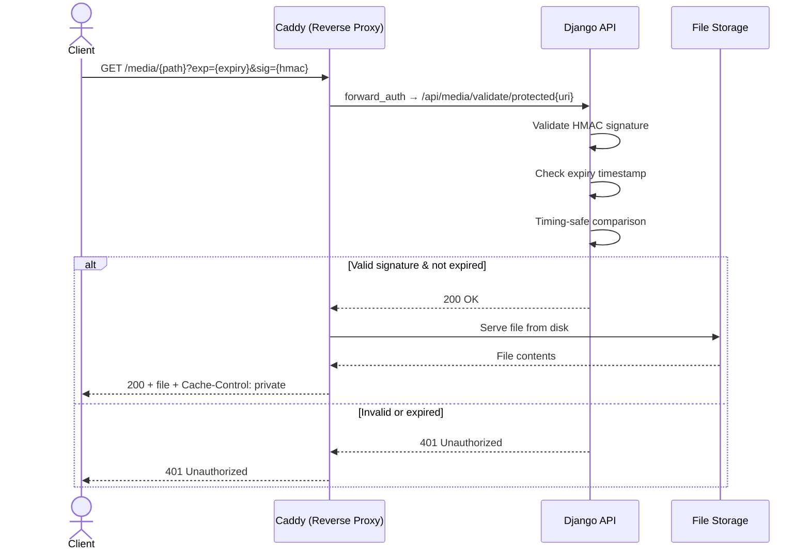

# Protected Files (HMAC)

Revel uses an **HMAC-based forward authentication** pattern to serve protected files through Caddy without exposing file storage directly. This approach keeps the architecture simple while providing robust access control.

!!! info "Related decision"
    See [ADR-0001: HMAC + Caddy over S3](../adr/0001-hmac-caddy-over-s3.md) for the full rationale behind choosing HMAC over pre-signed URLs.

## Architecture



## How It Works

1. **URL Generation**: When a schema serializes a protected file field, `get_file_url()` generates a signed URL containing an HMAC signature and expiry timestamp.
2. **Client Request**: The client requests the signed URL from Caddy.
3. **Forward Auth**: Caddy's `forward_auth` directive sends the request to Django's validation endpoint before serving the file.
4. **Validation**: Django recomputes the HMAC using `SECRET_KEY` (or any key in `SECRET_KEY_FALLBACKS`) and compares it using timing-safe comparison. It also checks that the expiry timestamp has not passed.
5. **Response**: If valid, Caddy serves the file directly from storage. If invalid, the client receives a 401.

## Why HMAC Over MinIO/S3 Pre-Signed URLs?

!!! warning "MinIO licensing change"
    MinIO moved to AGPL v3 and removed pre-compiled binaries for the community edition. This made it a less attractive option for self-hosted deployments.

| Factor | HMAC + Caddy | MinIO/S3 Pre-Signed URLs |
|---|---|---|
| **Additional services** | None (Caddy already serves files) | Requires running MinIO or S3 |
| **Licensing** | No restrictions | MinIO is AGPL v3 |
| **Complexity** | Django generates URLs, Caddy validates | SDK integration, bucket policies, IAM |
| **File size** | Perfect for <100MB (no streaming needed) | Better for large files with multipart upload |
| **Vendor lock-in** | None (pure Django + Caddy) | Tied to S3-compatible API |
| **Cost** | Zero additional infrastructure | Storage service costs |

!!! tip "Simple is better"
    For a platform where files are profile pictures, event banners, and documents (all well under 100MB), HMAC + Caddy is the right tool for the job.

## Model Fields

### ProtectedFileField & ProtectedImageField

Custom model fields that store files in a protected storage location:

```python
from common.fields import ProtectedFileField, ProtectedImageField


class Event(models.Model):
    banner = ProtectedImageField(
        upload_to="events/banners/",
        blank=True,
        null=True,
    )
    document = ProtectedFileField(
        upload_to="events/documents/",
        blank=True,
        null=True,
    )
```

These fields work identically to Django's `FileField` and `ImageField` but store files in the protected media directory.

## Signed URL Generation

In schemas, use `get_file_url()` to generate signed URLs:

```python
from common.signing import get_file_url


class EventSchema(ModelSchema):
    banner_url: str | None = None

    @staticmethod
    def resolve_banner_url(obj: Event) -> str | None:
        if not obj.banner:
            return None
        return get_file_url(obj.banner)
```

The generated URL has this structure:

```
/media/{file_path}?exp={expiry_timestamp}&sig={hmac_signature}
```

The signature is the HMAC-SHA256 of `{path}:{expires}`, truncated to 16 hex characters (64 bits). That is enough for access control because validation is rate limited and URLs are short-lived. Validity defaults to `DEFAULT_EXPIRES_IN` (3600 seconds) and is overridden per call with the `expires_in` argument (for example, signed Apple Wallet download links in ticket emails are valid until a week after the event ends).

## Security Details

!!! danger "Security-critical configuration"
    The HMAC signing uses Django's `SECRET_KEY`. If the secret key is compromised, all protected file URLs can be forged.

| Security Feature | Implementation |
|---|---|
| **Signing key** | `sha256("revel:signed-url:v1:" + secret)`, i.e. domain-separated from other uses of `SECRET_KEY` (not HKDF) |
| **URL expiry** | 1 hour by default; `expires_in` argument overrides it |
| **Comparison** | Timing-safe (`hmac.compare_digest`) |
| **Rate limiting** | Applied to the validation endpoint |
| **Cache headers** | `Cache-Control: private` for protected files |

### Key Rotation

New links are signed with the current `SECRET_KEY`. Verification accepts the current key and every entry of `SECRET_KEY_FALLBACKS`, so links issued before a rotation keep working until they expire (at most their validity window, 1 hour for media). Because links are short-lived, the fallback can be dropped as soon as that window has passed. See [Key rotation](../engineering-notes.md#key-rotation-secret_key-salt_key).

### Timing-Safe Comparison

!!! note "Why timing-safe?"
    Standard string comparison (`==`) leaks information about how many characters matched via timing differences. `hmac.compare_digest()` takes constant time regardless of how many characters match, preventing timing attacks.

## Caddy Configuration

!!! warning "Handle path ordering matters"
    In Caddy's configuration, the `handle_path` directives for protected and public media must be ordered correctly. Protected paths must be matched **before** public paths.

```
# Protected files - requires forward_auth
handle_path /media/protected/* {
    forward_auth web:8000 {
        uri /api/media/validate/protected{uri}
    }
    root * /srv/revel_media/protected
    header Cache-Control "private, max-age=3600"
    file_server
}

# Public files - served directly
handle_path /media/* {
    root * /srv/revel_media
    header Cache-Control "public, max-age=86400"
    file_server
}
```

!!! note "Path ordering"
    The `handle_path /media/protected/*` block must come before `handle_path /media/*` so that protected files are intercepted first.

### Cache Headers

| File Type | Cache-Control | Rationale |
|---|---|---|
| Protected files | `private, max-age=3600` | Must not be cached by shared caches; 1h matches URL expiry |
| Public files | `public, max-age=86400` | Public assets cached for 1 day |

## File Upload & Malware Scanning

!!! info "See [File Security](security.md)"
    Uploaded files are processed through an EXIF stripping and ClamAV malware scanning pipeline. Files that fail scanning are quarantined and never served. See the [File Security](security.md) page for the full architecture, scan flow, and notification details.
