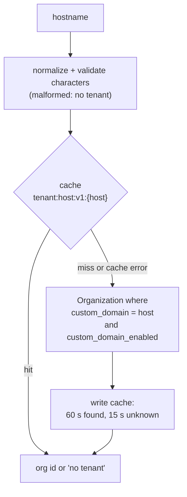
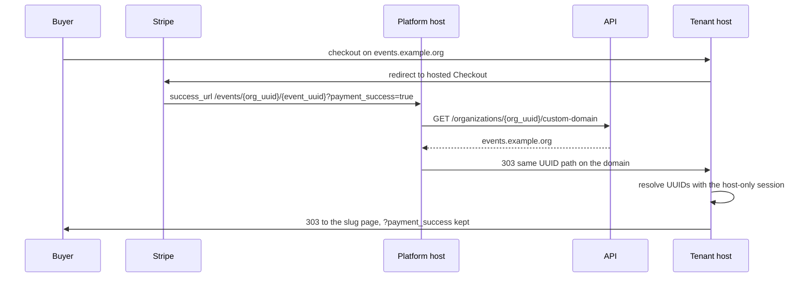
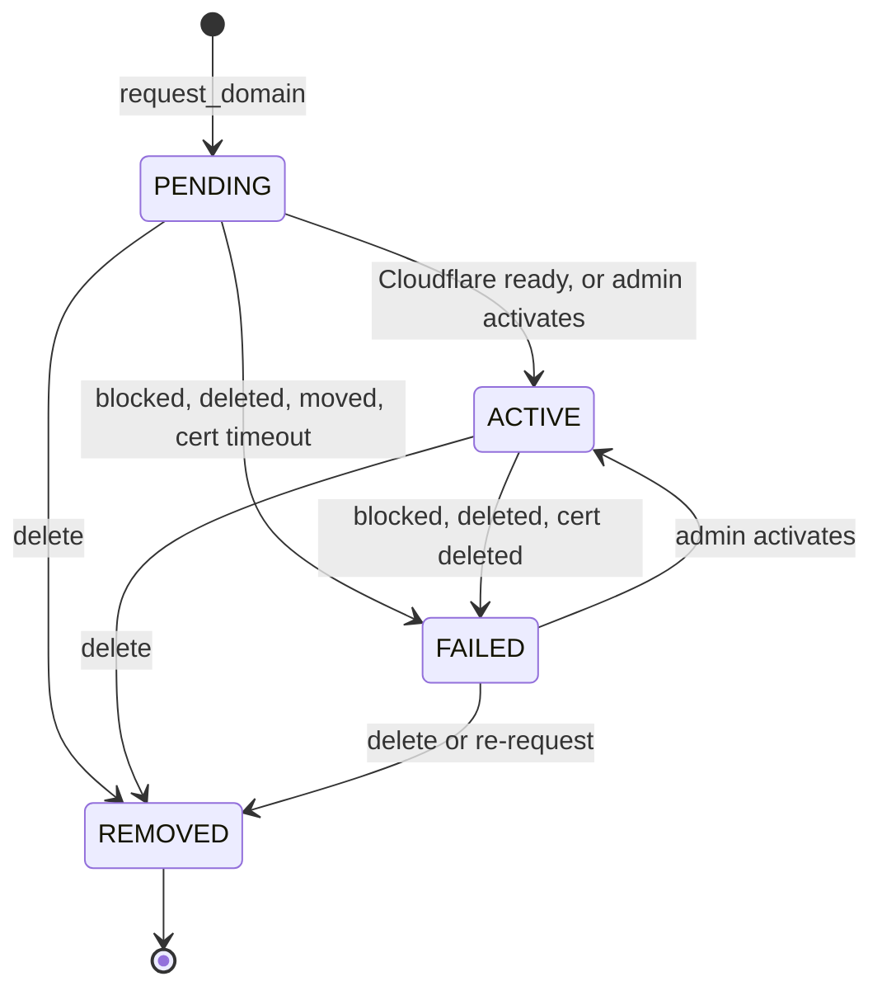

# White-Label Architecture

How Revel lets an organization present its attendee journey under its own brand colors and its own
domain, while staying one platform. For the user-facing story read the [white-label
guides](../guides/white-label/index.md); this page is for people changing the code. The frontend half
is described in [Tenant mode](https://github.com/letsrevel/revel-frontend/blob/main/docs/tenant-mode.md).

**One platform, many front doors.** Same backend, same database, same `RevelUser` accounts. A
custom domain is another hostname that resolves to an organization. There is no per-tenant instance
and no tenant column on other tables.

| Concern | Where it lives |
|---|---|
| Branding blob and validation | `events/utils/branding.py`, `Organization.branding` |
| Brand-theme derivation | `events/utils/brand_theme.py` |
| Wallet and PDF colors | `events/utils/pass_branding.py`, `wallet/`, `events/templates/events/_pass_brand_overrides.html` |
| Domain model | `events/models/organization_domain.py` |
| Hostname rules | `events/utils/hostname.py` |
| Domain lifecycle | `events/service/custom_domain_service.py` |
| Cloudflare client | `events/service/cloudflare_custom_hostnames.py` |
| Tenant resolution, cache, return host | `events/service/tenant_service.py` |
| Sync task, problem alerts, org-delete cleanup | `events/tasks/custom_domains.py` (`events.sync_custom_domains`, `events.notify_custom_domain_problem`, `events.delete_organization_cloudflare_hostnames`) |
| Guest seat-hold session (cookie and header) | `events/service/guest_hold_session.py` |
| Org-aware URLs | `events/utils/frontend_urls.py` |
| Tenant email sender | `notifications/service/org_sender.py` |
| Deploy checks | `events/checks.py`, `common/checks.py` |
| E2E fixtures | `events/management/commands/bootstrap_helpers/tenant_orgs.py` |

## Tenant resolution

Two columns on `Organization` drive everything:

- `custom_domain_enabled` (bool, default false): the platform-admin gate and **kill switch**. Django
  admin only, never in an API edit schema.
- `custom_domain` (unique, nullable, not editable): a **denormalized copy** of the hostname of the
  organization's ACTIVE `OrganizationDomain`. Schemas, URL builders and the email sender read a
  column instead of joining a table, so nothing in a hot path costs a query. Only
  `custom_domain_service` writes it.

`tenant_service` maps a hostname to an organization id:

- **TTLs.** Found answers are cached for 60 seconds (`POSITIVE_TTL`), unknown ones for 15 seconds
  (`NEGATIVE_TTL`). The short negative TTL is what bounds the cache key space, since any well-formed
  hostname gets an entry.
- **Fail open.** A broken cache degrades to the plain database lookup: a failed read counts as a
  miss, and a failed write or invalidation is logged and skipped. A cache outage never fails a
  request or a domain transition. A skipped invalidation is bounded by the TTLs.
- **Invalidation.** `invalidate_tenant_cache` runs on commit after every status change in the domain
  service, when the admin flips `custom_domain_enabled`, and when an organization is deleted
  (deleting cascades its domains around the service). A reader that queried the database just before
  a commit can still re-cache the old answer. That staleness is bounded by the TTL and is accepted;
  versioned keys are the noted upgrade path.
- **Kill switch.** The lookup filters on `custom_domain_enabled=True`. With the switch off the
  hostname does not resolve, `is_tenant_origin` is false (no CORS, no `return_host`), the
  `custom_domain` field is withheld from schemas (`CustomDomainMixin`), `frontend_base_url_for`
  returns the platform URL, the sender is the platform sender, the org-admin endpoints return 403,
  and the sync task skips the organization. The stored hostname survives, so flipping back restores
  the domain. Timings, verification steps and the frontend's own caches are in the
  [kill-switch runbook](../guides/white-label/operators.md#kill-switch-runbook). Because the sync
  skips the organization while the switch is off, a domain Cloudflare deletes in the meantime can
  still resolve for up to one sweep (15 minutes) after re-enabling, until the next run marks it
  failed. Email links read the organization through a 60-second cache
  (`ORG_LINK_TTL` in `notifications/utils.py`), so they fall back to the platform within that bound.

## Public endpoints

Both are anonymous and registered **before** the `/{slug}` routes, because `by-domain` is otherwise
a valid slug.

**`GET /api/organizations/by-domain/{hostname}`** (`TenantOrganizationSchema`) is what the tenant
frontend calls on first load for a non-platform host. Lowercase hostname, no port. 200 carries:
`id`, `slug`, `name`, `description`, logo and cover URLs (with thumbnails), `branding`,
`brand_theme`, `custom_domain`, `accept_membership_requests`, and `has_membership_plans` /
`has_resources`, two cheap `EXISTS` annotations that drive navigation. 404 for unknown, pending,
failed and removed domains and for organizations whose kill switch is off.

It answers for the organization **whatever its visibility**. The hostname is public DNS, so the
mapping reveals nothing; the content endpoints still enforce visibility per viewer. Gating the
lookup on visibility would make private and members-only organizations unservable on their own
domain.

**`GET /api/organizations/{organization_id}/custom-domain`** (`OrganizationCustomDomainSchema`:
`{"custom_domain": "..."}`) exists for the Stripe return flow (see below). It is public for the
same reason as above and for one more: the platform host that receives the buyer has no session for
them, and the regular organization retrieve answers 404 anonymously for private and members-only
organizations. The id is an unguessable UUID, so it is not an enumeration vector. 404 unless the
organization has an ACTIVE domain and the switch is on.

`custom_domain` (active only, and only with the switch on) is also exposed on
`MinimalOrganizationSchema`, `OrganizationInListSchema` and `OrganizationRetrieveSchema`, so the
frontend can link events straight to the right host without a redirect hop. The value is a plain
column, so lists add no queries. Organizations with a domain **stay listed in Revel discovery**;
the `UNLISTED` visibility is the opt-out.

## Dynamic CORS

A tenant frontend on `https://events.example.org` calls the API at the platform API host, so it is
a cross-origin request with credentials. The static `CORS_ALLOWED_ORIGINS` cannot list customer
domains, so `events/signals.py` registers a receiver on django-cors-headers' `check_request_enabled`
signal. When the static allow-list does not match, the receiver asks
`tenant_host_from_origin(request.headers["origin"])`, which requires:

- the scheme is `https` (`http` is accepted only when `DEBUG`),
- the host (port ignored) is the active custom domain of an organization,
- that organization's kill switch is on.

A truthy answer enables CORS for the request with the usual credentials and header settings.

## The branding JSON blob

`Organization.branding` is a `JSONField(default=dict)` validated by the pydantic
`OrganizationBranding` model: `primary_color` and `accent_color`, each `#RRGGBB` or `null`,
normalized to uppercase, `extra="forbid"`, frozen. `Organization.clean()` re-validates it, and
`save()` runs `full_clean()`.

- **Reads are tolerant.** `parse_branding()` returns empty branding (and logs a warning) for a
  stored blob that does not validate, for example one written around `clean()` with a queryset
  update. A bad blob never causes a 500.
- **Writes.** `PUT /organization-admin/{slug}/branding` takes the whole object and replaces the
  stored value, so `{}` clears it. The brand fields are not part of `OrganizationEditSchema`. A
  preview endpoint, `GET /organization-admin/{slug}/brand-theme-preview?primary=&accent=`, runs the
  same derivation without saving. Both need `edit_organization`.
- **Reads on payloads.** `branding` plus the computed `brand_theme` appear on the minimal,
  retrieve, admin-detail and tenant schemas (`OrganizationBrandingMixin`).

!!! note "The boundary rule"
    The blob holds **only org-owned presentation choices** an organization admin may change freely.
    Every new key must have a default, so existing rows stay valid with no data migration. Files
    (logo, cover art), `custom_domain` (unique, looked up on every request) and platform-admin flags
    (`custom_domain_enabled`, any future "hide Powered by Revel") stay real columns, so an
    organization admin cannot grant themselves a platform switch through the branding endpoint.

Why a blob and not columns: presentation choices will grow (typography, header style), they are
read together and never queried, and a blob adds keys without a migration per key. The cost is that
the schema lives in pydantic, not the database, which the tolerant read and the `clean()` check
compensate for.

## Brand-theme derivation

`derive_brand_theme(primary, accent)` is a pure, deterministic, memoized (`lru_cache`) function.
It returns `None` without a primary (an accent alone is ignored), otherwise a frozen `BrandTheme`
with a `light` and a `dark` `BrandColors`: `primary`, `primary_foreground`, `accent`,
`accent_foreground` (accent fields `None` without an accent).

**Why per mode.** Revel's own theme uses different primaries per mode because no single color
reaches the contrast target against both page backgrounds. Rejecting colors that fail one mode
would refuse Revel's own purple, so the server accepts any valid hex and derives a variant.

**Surfaces.** A color must pass against the *worse* of the page background and the card in its
mode. The values mirror the frontend's `--background` and `--card` tokens (and its
`scripts/audit-brand-themes.py`):

| Mode | `--background` (HSL) | `--card` (HSL) |
|---|---|---|
| Light | `268 60% 96%` = `#F4EFFB` | `0 0% 100%` = `#FFFFFF` |
| Dark | `270 35% 10%` = `#191122` | `270 30% 14%` = `#24192E` |

**Thresholds.** Primary >= **4.5:1** (it doubles as link text, WCAG 1.4.3). Accent >= **3:1**
(non-text UI, WCAG 1.4.11). The foreground is `#000000` or `#FFFFFF`, whichever contrasts more with
the final color, which is always at least 4.5:1.

**Algorithm** (`ensure_contrast`). If the color already passes against every surface of the mode, it
is returned unchanged (uppercased). Otherwise keep hue and saturation and shift HSL lightness in
1% steps, darker for light mode and lighter for dark mode, until the first candidate that passes.
Black or white clears 4.5:1 against every surface in its direction, so the loop always ends within
100 steps. Contrast is the WCAG 2.x relative-luminance ratio.

**Golden vectors.** These fixed cases (`events/tests/test_brand_theme.py::GOLDEN_VECTORS`) are also
consumed by the frontend as a fixture, so both sides catch drift. Each cell is `primary / foreground`
then `accent / foreground`:

| Primary | Accent | Light | Dark |
|---|---|---|---|
| `#8C3CDD` | `#F9B233` | `#8C3CDD` / `#FFFFFF`, `#C07D06` / `#000000` | `#A667E5` / `#000000`, `#F9B233` / `#000000` |
| `#8C3CDD` | none | `#8C3CDD` / `#FFFFFF` | `#A667E5` / `#000000` |
| `#FEFEFE` | none | `#6D6D6D` / `#FFFFFF` | `#FEFEFE` / `#000000` |
| `#0A0A0A` | none | `#0A0A0A` / `#FFFFFF` | `#878787` / `#000000` |
| `#FF0000` | none | `#DB0000` / `#FFFFFF` | `#FF2E2E` / `#000000` |
| `#FFFF00` | `#00FF00` | `#707000` / `#FFFFFF`, `#009E00` / `#000000` | `#FFFF00` / `#000000`, `#00FF00` / `#000000` |
| `#808080` | none | `#6E6E6E` / `#FFFFFF` | `#858585` / `#000000` |

The frontend never does contrast math; it converts the backend's hex values into its token format.
Changing a surface token, a threshold or the step in either repo means updating both and the
vectors.

## Org-aware URL building

`events/utils/frontend_urls.py` holds two helpers, deliberately light (no service imports; they
read the cached `SiteSettings` singleton):

- `frontend_base_url_for(org)` returns `CUSTOM_DOMAIN_URL_TEMPLATE.format(hostname=...)` when the
  organization has an active `custom_domain` **and** `custom_domain_enabled`, else
  `SiteSettings.frontend_base_url`. It never queries beyond the cached singleton, so pass an
  organization you already hold.
- `frontend_base_url_for_domain(custom_domain, enabled)` is the same rule for callers that hold the
  two column values (for example from a cache).

Attendee-facing links are canonical on the custom domain (the frontend 301s platform URLs there),
so notifications, invitations, waitlist offers, announcements, membership mail and the organization
signature of emails all use `frontend_base_url_for`. These **stay on the platform**:

- organization-admin links, Stripe Connect onboarding links,
- Stripe return URLs (below),
- Telegram keyboards,
- every account-security link and unsubscribe link (next section).

### The security rule: no account-level tokens on tenant domains

An organization owner controls the DNS of their custom domain and can repoint it at their own
server at any time. Account-security tokens (email verification, password reset, email-change
confirmation, account-deletion confirmation, unsubscribe) are **platform-wide credentials**. If
they were ever placed on a tenant-domain link, and the domain were derived from the request, an
owner could ask for a password reset for any Revel user, receive the token at their own server and
take over the account on every organization. So:

1. **Token links always use the platform base URL.** `send_account_email` builds
   `site_settings.frontend_base_url + link_path`, never a tenant base.
2. **The tenant travels only as a return hint**, `&return_host=<hostname>`. Account controllers call
   `tenant_return_host(request)`, which reads the request's `Origin` header through the same
   `tenant_host_from_origin` check as dynamic CORS: an https origin whose host is an ACTIVE tenant
   domain with the kill switch on. Anything else yields `None` and no hint. The hint rides in the
   task's existing `context` dict, so a rolling deploy works in both directions (an older worker
   ignores the unknown key and sends the email without the hint; a message queued before the change
   has none).
3. **The frontend validates the hint again** (tenant mode on, bare hostname, not a platform host,
   resolves to an active tenant) and, after the confirmation succeeds, redirects to the tenant
   built from the URL template with **no token** in that redirect. A forged `return_host` can at
   worst send a user to a real tenant's login page.
4. **Branding is not a credential.** The organization's name and logo in an account email may follow
   the tenant derivation.
5. **Server-side form actions forward `Origin`.** The frontend sets `Origin: <tenant origin>` on
   SvelteKit form actions (register, password-reset request, email-change request, deletion
   request), since browser-originated calls already carry it.

Audit result of the URL change: the only token on a tenant-domain link is the **guest
confirm-action token**, single-use, scoped to one RSVP or ticket on that organization's own event,
returning no auth session. That is acceptable because the owner already has authority over that
event. Unsubscribe tokens and account links stay on the platform.

### Ownership proof: dangling-CNAME re-claim

Cloudflare for SaaS activates a custom hostname as soon as its CNAME points at the fallback origin
(HTTP validation); it does not need the ownership TXT record. Without a check of our own, a domain
that was removed (or whose organization was deleted) while its CNAME still pointed at Revel could be
requested by **another** organization with the feature enabled, and the next sync would activate it
for them. The same race exists when a legitimate owner sets the CNAME before requesting the domain.
So `sync_domain_status` requires the per-hostname ownership TXT record to be visible in public DNS
before a PENDING domain becomes ACTIVE: only whoever controls the zone can publish it.

### The password trade-off

The rule above protects **tokens**. It does not, and cannot, protect the **password form**. On a
custom domain an attendee logs in on a page served under a hostname whose DNS the organization
controls. Sessions are host-only, so each domain asks for its own login, and the password is typed
into whatever answers on that hostname. An owner who is malicious, or whose DNS account is taken
over, can repoint the hostname at their own server and serve a look-alike login page that collects
passwords. Revel never puts an account token on such a link, but a visitor who opens the custom domain is
trusting the owner's DNS.

This is inherent to "login per domain" white-label: the login has to live on the domain to keep the
organization's look and host-only sessions. Revel does not pretend otherwise. It limits who can get
there and how long a problem lives:

- **Enablement is platform-admin only.** `custom_domain_enabled` is a superuser-only Django admin
  field, never in an API edit schema, so a custom domain is something the operator grants
  to organizations it trusts.
- **The kill switch** takes a domain out of service in about a minute without touching DNS (see the
  [runbook](../guides/white-label/operators.md#kill-switch-runbook)).
- **Problem alerts** tell staff when a live domain starts failing (for example Cloudflare reports
  the CNAME `moved`), which is one way a repointed hostname shows up.
  See [domain-problem alerts](../guides/white-label/operators.md#domain-problem-alerts).
- **Account-level tokens stay off tenant links**, so a hostile domain cannot harvest reset or
  verification tokens. The remaining exposure is the password form itself.

Operators should treat enabling a custom domain as granting the organization the ability to present
a login page under its own name, and decide accordingly.

## The Stripe return policy

Checkout and billing-portal return URLs (ticket, series-pass and membership success and cancel, and
the billing-portal default) are built from the **platform** frontend URL with their existing UUID
paths (`/events/{org_uuid}/{event_uuid}?payment_success=true`), never from the custom domain. Two
reasons:

1. **The #848 policy.** Stripe must receive nothing organizer-authored and nothing conditional per
   organizer. A custom hostname in `success_url` is organizer-chosen.
2. **Idempotency.** Session creation uses `idempotency_key=reservation_id`. Return URLs that
   depend on mutable organization state (a domain sync, the kill switch) could produce a
   byte-different retry, which Stripe rejects with a conflict (a 500 until the hold lapses). A
   platform URL is byte-identical across retries.

The frontend closes the loop with three hops, keeping the query string
(`payment_success` / `membership_success` survive):

A lookup failure or an organization without a domain falls back to the platform's own flow, so a
buyer is never sent to an error page on the way back from a payment.

## Domain lifecycle

`OrganizationDomain` records a request and its status. Only the ACTIVE one is resolved, through the
denormalized column.

**Fields.** `hostname`, `status`, `cloudflare_hostname_id`, `verification_records` (DNS records to
create: the CNAME plus any TXT from Cloudflare, de-duplicated), `last_errors` (Cloudflare's problem
messages at the last sync), `verified_at`.

**Constraints** (partial unique constraints):

- `unique_hostname_among_non_removed`: a hostname is unique among non-REMOVED rows, so removal frees
  it.
- `one_live_domain_per_organization`: at most one PENDING or ACTIVE row per organization.

**Hostname rules** (`events/utils/hostname.py`): normalized to lowercase, IDNA, no trailing dot; at
least one dot; no port, wildcard or IP; at most 253 characters with labels of at most 63; a TLD that
is not numeric; and neither equal to nor under the platform's own hosts (from `FRONTEND_BASE_URL` and
`BASE_URL`) or their registrable apex, taken naively as the last two labels. `*.localhost` is
accepted only when `DEBUG`, for development and E2E.

**REMOVED is terminal.** `_save_status` refuses any transition out of it, because it frees the
hostname for other organizations. Re-requesting a removed hostname is a new row.

**Transition mechanics.** Every transition runs in a transaction holding the organization's row
lock, keeps `Organization.custom_domain` in step (set on ACTIVE; cleared when the domain being
withdrawn is the published one), and invalidates the tenant cache on commit. Rows are written with
queryset updates, not `save()`, so a status change is never blocked by field validators (a hostname
no longer valid under current settings must still be removable). The two unique constraints are
checked explicitly with `validate_constraints()`, so a conflict surfaces as a `ValidationError`
instead of an `IntegrityError`.

**Provisioning** (`request_domain`): validate, check for a live domain and hostname collisions,
retire the organization's FAILED domains (so retrying needs no manual delete), **then** call
Cloudflare synchronously, **then** insert the PENDING row. The order means a Cloudflare failure
leaves no orphan row (the request answers 502), and the organizer gets the DNS records in the
response. If the insert fails, or Cloudflare created the hostname but returned an unusable result,
the just-created Cloudflare hostname is deleted best effort. A Cloudflare 409 or error code 1406 maps
to a conflict. Hostnames are created with HTTP validation and a DV certificate.

**Sync** (`sync_domain_status`) is a **compare-and-set**. It reads Cloudflare for a PENDING or
ACTIVE domain, refreshes the records and errors, decides a target status for the status the domain
had when it was read, then re-reads the status under the organization lock and applies the
transition only if it is unchanged. A concurrent delete or sync wins and the decision is dropped.
The target is decided as follows:

- hostname `blocked` or `deleted`, or certificate `deleted`: FAILED, for **PENDING or ACTIVE**
  domains;
- hostname `moved` or a certificate `*_timed_out` state: FAILED for **PENDING only**. On an ACTIVE
  domain the status is kept and the message goes to `last_errors`. `moved` also means "the hostname
  no longer points to the fallback origin", which is recoverable by restoring the CNAME until
  Cloudflare deletes it after seven days (and then reports `deleted`);
- hostname and certificate both `active`: ACTIVE for a PENDING domain, **but only if the ownership
  TXT record** (`ownership_verification`) is published in public DNS (checked over DNS-over-HTTPS,
  outside the lock). Otherwise the domain stays PENDING with a "add the TXT record" message in
  `last_errors`. It fails closed: a missing `ownership_verification` or a failed lookup also keeps
  it PENDING. ACTIVE domains are not re-checked, and `activate_domain` (admin, seeds) is not gated;
- anything else (`active_redeploying`, ...): no change.

`events.sync_custom_domains` calls it every 15 minutes with per-domain error isolation, and the
owner's refresh endpoint calls it on demand. Without Cloudflare configured nothing is provisioned
and the task is a no-op; staff activate by hand.

**Active-domain alerts.** A live domain that goes wrong is invisible to visitors until it breaks, so
`sync_domain_status` raises the alarm on the **edge**, never on every sweep:

- *Clean to problem on an ACTIVE domain* (`expected == ACTIVE`, new `last_errors`, none before): the
  status is kept, a structlog WARNING `custom_domain_active_problem` is written (domain id,
  hostname, organization id, problems) and the task `events.notify_custom_domain_problem` is
  dispatched on commit.
- *ACTIVE to FAILED* (`blocked`, `deleted`, certificate `deleted`): the same with
  `custom_domain_active_failed`, after the transition commits.

The task emails every active superuser and staff user in one BCC'd message (hostname, organization,
status, Cloudflare's messages); with no recipients it logs `custom_domain_alert_no_recipients`. It
follows the other operational alerts (malware, GDPR export failure), which email staff
unconditionally, rather than the `SiteSettings`-gated Pushover/Discord admin notifications, so there
is no new setting. A persisting problem does not re-alert. The operator response is in the
[operator guide](../guides/white-label/operators.md#domain-problem-alerts).

**Organization deletion.** Deleting an organization cascades its `OrganizationDomain` rows around
the service, which would orphan their Cloudflare hostnames. A `pre_delete` receiver on
`Organization` captures the `cloudflare_hostname_id`s before the cascade; the existing `post_delete`
receiver dispatches `events.delete_organization_cloudflare_hostnames` on commit. The task deletes
each hostname best effort (404 means gone, other failures log
`custom_domain_orphaned_cloudflare_hostname`, no Cloudflare configuration is a logged skip), so
deletion never waits on or fails because of Cloudflare.

## Wallet passes and PDFs

`get_pass_brand_colors(org)` (`events/utils/pass_branding.py`) is the one mapping from an
organization to pass colors, so Apple Wallet, Google Wallet and the PDFs cannot drift. It returns
`None` for an unbranded organization (callers keep the Revel defaults untouched) or a frozen
`PassBrandColors`:

- `background`: the organization's **primary as entered**. A wallet card or PDF banner is a solid
  surface, not text on the page, so the page-contrast shifting would only make the brand less
  recognizable (a light pink turning brown);
- `foreground`: black or white, whichever contrasts more (at least 4.5:1);
- `text_accent`: the **light-mode derived primary**, used for small text and thin rules on the
  white and lavender PDF paper, where legibility is guaranteed.

Apple passes take background, foreground and label colors from it, and use a solid fill instead of
the Revel purple-to-crimson gradient for the blurred background image. The accent color is not used
on passes. The PDFs include `_pass_brand_overrides.html`, one `<style>` block that renders to the
empty string when there is no brand, so unbranded output stays byte-identical. The "Powered by
revel." lockup is never recolored.

**Google Wallet ID fingerprint.** Google treats a save JWT whose class or object ID already exists
as a no-op and serves the stored entity unchanged, so a pass saved before the organization changed
its colors would stay Revel purple forever. `_brand_suffix(org)` appends `-` plus the first eight
hex characters of the SHA-256 of the `PassBrandColors` JSON to the event and series class IDs and the
membership-card object ID, minting a new entity whenever the colors change. Unbranded organizations get
no suffix, so every existing ID is untouched. Cards saved earlier keep their old look; new saves get
the new one.

**Cache hash.** Generated ticket and series-pass files are cached under a hash of the things that
change them. `ticket_file_service` and `series_pass_file_service` add `brand=<PassBrandColors JSON>`
to that hash **only when branded**, so a branding change invalidates the cache and unbranded hashes
(and their cached files) stay valid.

## The tenant organization sender

Mail an organization sends goes out as `"<Org> via Revel" <slug@ORG_EMAIL_DOMAIN>`. For a
white-label tenant (`is_white_label_tenant(org)`: active `custom_domain` **and** `custom_domain_enabled`)
the same sender also covers attendee transactional mail, the set `TENANT_ORG_SENDER_TYPES` in
`notifications/enums.py` (tickets, payments, holder-facing membership, series-pass and subscription
mail, waitlist offers, questionnaire results), and the guest RSVP and ticket confirmations. The gate
reads columns on the one organization lookup that already resolves the sender
(`SENDER_ORG_FIELDS`). Staff-facing types and Revel's own billing mail stay on the platform sender,
as do unsubscribe links. When `ORG_EMAIL_DOMAIN` is unset the domain falls back to the domain of
`DEFAULT_FROM_EMAIL`. Details, headers and Reply-To rules: [Email Sending &
Opt-Out](email-sending.md#sender-identity). The rollout order is in the [operator
guide](../guides/white-label/operators.md#email-rollout-order).

Organization emails show the organization's logo through the stable
`/api/organizations/{id}/logo` endpoint (the same indirection Google Wallet uses): raw media URLs die
when a logo is replaced, and emails live on.

## Guest seat holds on tenant domains

Anonymous seat holds are owned by a signed **guest session** (`events/service/guest_hold_session.py`,
valid 24 hours). It started life as the httpOnly, `SameSite=Lax` cookie `revel_guest_hold` on the
API host. A browser on a tenant domain is **cross-site** to the API host, so it never stores or sends
that cookie, and anonymous holds, guest checkout and the confirm page (which opens on the tenant
host) would all lose the session. The session therefore has a second channel that survives
cross-site:

- **Response body.** `HoldResponseSchema.guest_hold_token` (on `POST /events/{id}/seating/holds` and
  `.../holds/best-available`, including their 409 bodies) carries the same signed token. It is
  returned **only when the response freshly minted the session, or when the caller sent it in the
  header**. A session resolved from the httpOnly cookie alone is never echoed, so script cannot read
  the cookie's value. It is `null` for authenticated users and on release.
- **Request header.** The frontend stores the token first-party and sends it as `X-Guest-Hold` on
  seating, guest checkout, guest RSVP and guest confirm calls.
- **Precedence.** One helper, `resolve_request_guest_hold(request)`, serves every reader: header
  first, then cookie. A missing, tampered or expired value counts as absent, so a stale header never
  shadows a valid cookie, and with neither the caller has no session (a hold request mints one).
- **CORS.** `x-guest-hold` is in `CORS_ALLOW_HEADERS`, for platform and tenant origins alike.
- The cookie is still set when a session is minted, so the platform flow does not change.

A cookie audit of `src/` found no other cookie used from a tenant host: `oidc_state` and the
integrations connect-state cookie belong to top-level navigations on the platform host, and the API
sets no Django session or CSRF cookie (JWT bearer auth).

## Rolling deploys

White-label ships in a window where web pods and Celery workers run different releases, in either
order. Two rules keep both directions working:

- **New NOT NULL columns have database defaults.** `Organization.custom_domain_enabled` has
  `db_default=False` and `Organization.branding` has `db_default='{}'::jsonb`, so a pod on the
  previous release, which does not know the columns, can still insert organizations.
- **Task call shapes are unchanged.** `send_guest_rsvp_confirmation` and
  `send_guest_ticket_confirmation` are called with exactly their pre-white-label arguments. The
  optional trailing `organization_id` remains an override, and when it is absent the task derives
  the organization from the confirmation token's event with one `.only(*SENDER_ORG_FIELDS)` query
  (an unreadable token falls back to the platform). The account email tasks keep their call shape
  too: the `return_host` hint rides in the existing `context` dict, which an older worker ignores.
  A message queued before the change simply has no hint.

## E2E fixtures

The frontend 301s the platform URL of any organization with an active custom domain, so a domain
must never sit on a shared fixture organization that other journeys visit on the platform host.
`bootstrap_helpers/tenant_orgs.py` therefore seeds dedicated organizations, owned by
`tenant.owner@example.com` (password `password123`), as part of `bootstrap_test_events`:

| Organization (slug) | Domain | Branding | Contents |
|---|---|---|---|
| Tenant Test Org (`tenant-test-org`) | `tenant.localhost` (ACTIVE) | `#B0306A` / `#2E86DE` | `tenant-rsvp-event` (RSVP), `tenant-free-ticket-event` (a free "Free Ticket" tier) and `tenant-seated-event` (seat map, free "Seated Free" tier) |
| Tenant Paid Org (`tenant-paid-org`) | `paid.localhost` (ACTIVE) | `#0E7C66` / `#F2A541` | `tenant-paid-event` with an online "Standard Ticket" tier at 10 EUR, and `tenant-paid-seated-event` (seat map, online "Seated Standard" tier at 10 EUR). When `STRIPE_ACCOUNT` is a real `acct_` id that no other organization holds, the organization uses the platform account, so test-mode checkouts work; otherwise paid checkout fails and a warning is logged |
| Domain Setup Org (`domain-setup-org`) | none | none | Kill switch on and no domain, so the admin UI can request one |

The two seated events exist to E2E-test anonymous seat holds followed by guest checkout on a custom
domain (see [guest seat holds](#guest-seat-holds-on-tenant-domains)). Both are public, open,
upcoming and allow attending without login. Each has its own venue, named `<Org Name> Hall`, with
one seated sector `MAIN` ("Main Floor") of three rows (A to C) of six seats, labelled `A1` to `C6`,
and a single `USER_CHOICE` tier over that sector, so guests choose their seats. The free event
completes without Stripe; the paid one uses the guest online checkout flow and needs the platform
Stripe account described above.

Requirements and behavior:

- `*.localhost` hostnames are valid only under `DEBUG`, so the tenant fixtures are skipped with a
  warning otherwise.
- Domains are created through the real service (`activate_domain`), not by writing columns.
- Dynamic CORS accepts `http` origins under `DEBUG`, and development and E2E use
  `CUSTOM_DOMAIN_URL_TEMPLATE=http://{hostname}:5173` (with the frontend's
  `PUBLIC_CUSTOM_DOMAIN_URL_TEMPLATE` set to the same value).
- Chromium resolves any `*.localhost` name to loopback, so no `/etc/hosts` entry is needed. The
  frontend's local-development notes are in its
  [tenant-mode doc](https://github.com/letsrevel/revel-frontend/blob/main/docs/tenant-mode.md#local-development-and-e2e).

See also [Demo & Seeding](../guides/demo-and-seeding.md#white-label-tenant-fixtures).

## Related

- [Organizer guide](../guides/white-label/organizers.md) and [operator guide](../guides/white-label/operators.md)
- [Email Sending & Opt-Out](email-sending.md): sender identity for tenants
- [Engineering notes](../engineering-notes.md): Stripe session idempotency (`idempotency_key=reservation_id`)
- [Protected Files](protected-files.md): media served by Caddy, whose CORS must allow tenant origins
