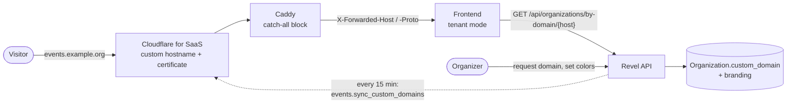

# White-Label

White-label on Revel means an organization can present its attendee journey under its own look:
its own brand colors on every page, and optionally its own domain such as `events.example.org`,
instead of the Revel look and the Revel address. It is still one platform. There is one backend,
one database and one set of Revel accounts. A custom domain is another front door to the same
organization, not a separate instance.

This section has three guides, one per audience, plus an architecture page for people changing
the code.

| You are... | Read |
|---|---|
| An organizer who wants brand colors or a custom domain | [Organizer guide](organizers.md) |
| Running a Revel instance (hosted or self-hosted) and enabling domains for organizations | [Platform operator guide](operators.md) |
| Working on the backend | [White-label architecture](../../architecture/white-label.md) |

The frontend half (how a host becomes a tenant, which routes exist on a tenant domain, SEO,
embeds) lives in the frontend repository: [Tenant mode](https://github.com/letsrevel/revel-frontend/blob/main/docs/tenant-mode.md),
[Embeds](https://github.com/letsrevel/revel-frontend/blob/main/docs/embeds.md) and the
[deployment runbook](https://github.com/letsrevel/revel-frontend/blob/main/docs/runbooks/deployment.md).
This guide links to those pages instead of repeating them.

## What an organization gets

There are two layers, with different gates.

| | Brand colors | Custom domain |
|---|---|---|
| What it is | A primary color and an optional accent that restyle the organization's pages, embeds, wallet passes and ticket PDFs | The whole attendee journey (organization page, events, applications, checkout) served from the organization's own hostname |
| Who can use it | Every organization, free | Organizations a platform admin has enabled (a Django admin flag) |
| Who sets it up | Organizers with the "edit organization" permission | The organization **owner**, once the platform has enabled it |
| Needs DNS work | No | Yes, one CNAME record at the organization's DNS provider |

On a custom domain the visitor sees the organization's name and logo in the header, the
organization's colors across the whole site (login, account and legal pages included), only the
organization's own events, and an organization-scoped sitemap, favicon and page titles. Platform
discovery and marketing pages do not appear there.

Organization emails that carry the organization's identity show its logo, and links in attendee
emails (tickets, invitations, reminders, payment confirmations) point at the custom domain once it
is active.

## The deliberate limits

White-label on Revel is not "run your own ticketing site with the platform hidden". Some things
stay Revel's on purpose, and each has a reason.

**Accounts are shared Revel accounts.** An attendee who signs up on `events.example.org` creates a
Revel account, the same account they would get anywhere else on Revel. Revel stays the data
controller for accounts, which is why the footer links to Revel's privacy policy and terms. Sessions
are host-only, so each domain asks for its own login. Single sign-on buttons are hidden on custom
domains, because the OIDC callback belongs to the platform.

**The footer says "Powered by Revel · Privacy · Terms".** Every tenant page keeps this small
footer, and organizers cannot turn it off.

**Email comes through Revel.** Mail an organization sends goes out as `"<Org> via Revel"
<org-slug@mail.letsrevel.io>` (the domain is the operator's `ORG_EMAIL_DOMAIN`), with Reply-To set
to the organization's verified contact email. On a custom domain, ticket and payment emails to
attendees use the same organization sender. Sending from the organization's own domain is not
supported. Account emails (verification, password reset, account deletion) always come from
Revel and always link to Revel's own site, never to the custom domain. The [organizer
guide](organizers.md#account-emails-and-why-they-link-to-revel) explains why.

**Checkout is Stripe hosted Checkout.** Payments go through the organization's own Stripe account,
so the Stripe page already shows that account's branding. Revel does not embed the payment form in
the page. The return trip from Stripe starts on the Revel address and ends back on the
organization's domain.

**Organizations stay listed in Revel discovery.** An organization with a custom domain still
appears in Revel's own listings and search, and its events still show up in discovery. Opening one
leads to the organization's domain. An organization that wants to be reachable only through its own
domain sets its visibility to **Unlisted**: it then disappears from discovery listings but stays
reachable by direct link, including through its custom domain.

## How it fits together

1. The organizer requests a hostname in the admin area. The API registers it with Cloudflare and
   returns the DNS records to create.
2. The organizer creates the records. Cloudflare validates the hostname and issues a certificate.
3. A background task (or the organizer's "Check now") notices both are ready and marks the domain
   **active**. Only then does the hostname resolve to the organization.
4. A visitor opens the hostname. Cloudflare terminates TLS and forwards to Caddy, which forwards to
   the frontend with the original host. The frontend asks the API which organization owns that host,
   then renders that organization's site with its colors.

Without Cloudflare (self-hosting), steps 1 to 3 shrink to "a platform admin activates the domain in
the Django admin", and TLS is the operator's job. See [running without
Cloudflare](operators.md#running-without-cloudflare).

## Where to go next

- Organizers: [colors, custom domain and what attendees see](organizers.md)
- Operators: [enabling domains, Cloudflare, environment variables, go-live checklist](operators.md)
- Developers: [architecture](../../architecture/white-label.md)
